# 1-Week Intensive SEO Strategy, Anti-Spam Architecture & Keyword Masterplan for WillDrafting.in
**Target Market:** Resident Indians (Pan-India) & Non-Resident Indians / Overseas Citizens of India (NRIs/OCIs in USA, UK, UAE, Canada, Australia, Singapore, Europe) holding assets in India.  
**Platform:** `https://www.willdrafting.in` (Powered by AMA Legal Solutions)  
**Date Prepared:** October 14, 2026 (Updated with Anti-Doorway / Anti-Spam URL Architecture)

---

## Executive Summary & Core Positioning

**WillDrafting.in** operates in a strict **"Your Money or Your Life" (YMYL)** legal-tech vertical. In YMYL legal niches, Google's **Helpful Content System**, **Doorway Page Classifier**, and **Scaled Content Abuse Policy** heavily penalize domains that spin up templated city pages (`/will-drafting-in-mumbai`, `/will-drafting-in-bangalore`) or duplicated NRI country pages (`/nri-will-usa`, `/nri-will-uk`).

Why? Because **Will drafting in India is governed by national statutes** (the *Indian Succession Act, 1925*, the *Hindu Succession Act, 1956*, and the *Indian Stamp Act, 1899*). Because the legal clauses of a Will do not change between Pune, Hyderabad, and Noida, creating separate city or state pages produces 90% boilerplate duplicate text — which Google flags as **Doorway Abuse**, tanking sitewide domain authority.

### Our High-Authority, Zero-Spam Strategy
Instead of spammy programmatic pages, we will win using **Consolidated Topic & Intent Hubs** backed by **AMA Legal Solutions' E-E-A-T authority**:
1. **Only Create a URL When the Underlying Law or User Intent is 100% Distinct:** Separate URLs only for distinct legal frameworks (Hindu vs. Muslim Wasiyat vs. NRI FEMA/Two-Will Strategy vs. Sub-Registrar Registration vs. 2025 Probate Reform).
2. **Capture State/City & NRI Country Modifiers Inside Consolidated Hubs:**
   - **Why people search by State/City:** Users search by city/state for **Sub-Registrar (SRO) online portal rules** (*IGR Maharashtra*, *Kaveri Karnataka*, *NGDRS/DORIS Delhi*, *TNREGINET Tamil Nadu*) or **Presidency Town Probate rules** (*Mumbai, Chennai, Kolkata*). We capture all of these inside **one master Registration Hub** (with an interactive State SRO lookup table) and **one Probate Reform Guide** — zero doorway pages!
   - **Why NRIs search by Country:** NRIs in the US, UK, UAE, Canada, Australia, and Singapore need country-specific execution/witness/Embassy PoA rules. We capture all 6 countries inside **one powerhouse `/nri-will-india` page** using an interactive Country Tab Selector (`USA | UK | UAE | Canada | Australia | Singapore`), concentrating 100% of backlinks and PageRank into a single URL.

---

## Part 1: What Is Spammy vs. What Actually Works (Anti-Doorway Rules for Legal SEO)

| SEO Tactic | Google Crawler Classification | Why It Fails or Works in Indian Legal YMYL | Our Action on `WillDrafting.in` |
| :--- | :--- | :--- | :--- |
| **Creating 20+ City/State Pages** (`/will-drafting-mumbai`, `/will-drafting-delhi`, `/will-drafting-bangalore`) | **SPAMMY (Doorway Page Penalty)** | Will drafting under Section 63 ISA 1925 is identical nationwide. Swapping city names in H1s/meta tags creates thin, near-duplicate pages that trigger sitewide demotion. | **DO NOT CREATE.** Never create city/state landing pages for online Will drafting. |
| **Creating Separate NRI Country Pages** (`/nri-will-usa`, `/nri-will-uk`, `/nri-will-uae`, `/nri-will-canada`) | **SPAMMY (Cannibalization & Thin Content)** | 85% of the content (Indian Succession Act, FEMA, NRE/NRO rules) is identical across countries. Multiple URLs split link equity and cannibalize each other. | **DO NOT CREATE.** Build **one** canonical `/nri-will-india` page with interactive country tabs (US, UK, UAE, Canada, AU, SG) for local witness/consulate/tax nuances. |
| **Keeping Template/Off-Topic Blog Posts** (`/blogs/what-an-adjuster-is-doing-when-they-call`, etc.) | **TOXIC (Helpful Content / Topical Dilution)** | Currently in [`src/data/blogs.ts`](file:///Users/amalegalsolutions/Desktop/AMAWORK/willdrafting/src/data/blogs.ts#L26-L193), 3 of 6 indexed blogs are about US car-accident insurance adjusters. This confuses Google's sitewide topic vector. | **PURGE IMMEDIATELY (Day 1).** Delete all 3 US insurance posts and replace with authoritative Indian succession guides. |
| **Keyword Stuffing `<meta name="keywords">` or Footer City Lists** | **SPAMMY (Over-Optimization Signal)** | Listing 50 cities in the footer ("Will Lawyer in Mumbai | Will Lawyer in Pune...") looks like 2012 link-farm spam to Googlebot. | **DO NOT DO.** Use clean `areaServed` JSON-LD schema and natural statutory tables instead. |
| **Interactive State Sub-Registrar Table Inside 1 Registration Guide** | **WORKS (High Helpful Content Score)** | State registration portals (*Kaveri*, *IGR Maharashtra*, *DORIS*, *TNREGINET*) and SRO fees genuinely differ by state. A single guide with a state-by-state table ranks for every state query naturally. | **IMPLEMENT.** Include a complete State-Wise SRO Portal & Fee Table inside `/blogs/how-to-register-will-in-india`. |
| **Interactive Intestate Succession Calculator (`/succession-calculator`)** | **WORKS ( #1 Organic Traffic & Link Magnet)** | Proven by `iwills.in/hindu-succession-calculator` and `saralwill.com/#checker`. Gives unique utility based on religion, gender, and family tree, driving high dwell time and conversions to `/start`. | **IMPLEMENT (Day 5).** Build one unified calculator covering Hindu (Male s.8 / Female s.15), Muslim (1/3rd rule), Christian & Parsi laws. |
| **Statute-Specific Pillar Guides** (Hindu Coparcenary, Muslim Wasiyat, 2025 Probate Reform, Nominee vs Legal Heir) | **WORKS (Topical Authority & E-E-A-T)** | Each URL addresses a completely distinct Indian statute or Supreme Court doctrine, written by named Indian advocates at AMA Legal Solutions. | **IMPLEMENT (Days 1 & 4).** Maintain a tight, high-depth library of 10 distinct statutory guides. |

---

## Part 2: Exact, Non-Spammy URL Architecture to Follow (`18 Canonical URLs Total`)

To maximize crawl budget and concentrate PageRank, `WillDrafting.in` should have **exactly 18 indexable public URLs** (8 Core/Hub Routes + 10 Statutory Blog Guides). Every single URL below has **100% unique legal substance** and **zero template duplication**.

```mermaid
flowchart TD
    Root["/ (Homepage: Online Will Maker India)"]
    Root --> Svc["/service (Will Drafting, Advocate Review & Personal Law Matrix)"]
    Root --> Price["/pricing (Transparent Tiers: ₹2,490 / ₹4,990 / ₹9,990)"]
    Root --> NRI["/nri-will-india (NRI & OCI India Will Hub: US, UK, UAE, CA, AU, SG)"]
    Root --> Calc["/succession-calculator (Free Interactive Indian Inheritance & Nominee Tool)"]
    Root --> About["/aboutus (AMA Legal Solutions E-E-A-T Authority)"]
    Root --> Contact["/contact (Legal Advisory Desk)"]
    Root --> Blogs["/blogs (Indian Succession Journal Hub)"]

    Blogs --> B1["/blogs/nri-will-for-indian-property-two-will-strategy"]
    Blogs --> B2["/blogs/nominee-vs-legal-heir-india-supreme-court-rule"]
    Blogs --> B3["/blogs/probate-of-will-in-india-2025-amendment-mumbai-chennai-kolkata"]
    Blogs --> B4["/blogs/will-valid-on-plain-paper-india"]
    Blogs --> B5["/blogs/appoint-guardians-minor-children"]
    Blogs --> B6["/blogs/intestacy-rules-without-will"]
    Blogs --> B7["/blogs/ancestral-vs-self-acquired-property-will-hindu-succession-act"]
    Blogs --> B8["/blogs/how-to-register-will-in-india-state-sub-registrar-guide"]
    Blogs --> B9["/blogs/muslim-will-wasiyat-india-one-third-rule"]
    Blogs --> B10["/blogs/senior-citizen-will-doctor-medical-fitness-certificate-india"]
```

### 1. Core Commercial & Interactive Hub URLs (8 Routes)
| Exact Canonical URL | Page Purpose & Unique Value | Primary & Geo Keywords Captured (Without Doorway Pages) |
| :--- | :--- | :--- |
| `https://www.willdrafting.in/` | **Homepage:** Product showcase, 14-step guided wizard entry, bilingual + voice assistant demo, core FAQs. | `online will maker india`, `online will drafting india`, `make a will online india`, `legally valid online will india` |
| `https://www.willdrafting.in/service` | **Services & Personal Law Hub:** Explains Auto-Verified vs. Advocate-Reviewed Wills + full **Indian Personal Law Comparison Table** (Hindu s.8/s.15, Muslim, Christian, Parsi, Special Marriage Act). | `will writing services in india`, `lawyer verified will online india`, `estate planning services india`, `will under indian succession act 1925` |
| `https://www.willdrafting.in/pricing` | **Pricing & Plan Comparison:** Transparent one-time INR plans (`₹2,490`, `₹4,990`, `₹9,990`) with `Product` + `Offer` schema and stamp-paper/registration cost FAQs. | `will drafting charges in india`, `cost of making a will in india`, `lawyer fees for will drafting in india` |
| `https://www.willdrafting.in/nri-will-india` | **[NEW] Dedicated NRI & OCI Hub:** Single canonical hub for overseas Indians with interactive country tabs (`USA`, `UK`, `UAE`, `Canada`, `Australia/SG`), FEMA rules, NRE/NRO clauses, and parent care in India. | `nri will drafting india`, `online will for nri with property in india`, `indian will for nri in usa uk uae canada`, `separate will for indian assets` |
| `https://www.willdrafting.in/succession-calculator` | **[NEW] Free Interactive Tool:** Calculates exact statutory shares under Hindu (Male/Female), Muslim, Christian & Parsi intestate laws + checks Will vs. Bank/Demat Nomination. | `indian succession calculator`, `hindu succession act calculator`, `who inherits without a will in india`, `will vs nomination checker` |
| `https://www.willdrafting.in/aboutus` | **E-E-A-T Trust & Law Firm Page:** Showcases AMA Legal Solutions credentials, advocate bios, Bar Council compliance, and data encryption. | `will drafting law firm india`, `ama legal solutions will drafting`, `estate planning advocates india` |
| `https://www.willdrafting.in/contact` | **Advisory & Registration Support Desk:** Consultation booking for complex estates, HUF/trusts, and Sub-Registrar assistance. | `will drafting legal consultation india`, `estate planning lawyer contact india` |
| `https://www.willdrafting.in/blogs` | **Editorial Hub:** Categorized index of 10 statutory guides under Indian Succession Law. | `indian succession law guides`, `will drafting rules india blog` |

### 2. The 10 Canonical Blog Slug URLs (`src/data/blogs.ts`)
*(Note: Keep existing slugs #4, #5, #6 intact so we don't break existing indexed URLs; replace toxic slugs #1, #2, #3; and add #7–#10).*

| # | Exact Blog URL (`/blogs/[slug]`) | Status | Distinct Legal Statute / Topic Covered | Target Keywords & Natural Geo Reach |
| :--- | :--- | :--- | :--- | :--- |
| **1** | `/blogs/nri-will-for-indian-property-two-will-strategy` | **Replace US Adjuster Post #1** | Section 228 ISA (Foreign Probate Re-sealing), FEMA Non-Debt Rules, NRE/NRO/FCNR Repatriation (Form 15CA/15CB). | `two will strategy for nri`, `foreign will validity in india`, `can oci inherit agricultural land in india fema` |
| **2** | `/blogs/nominee-vs-legal-heir-india-supreme-court-rule` | **Replace US Medical Post #2** | Supreme Court precedents (*Sarbati Devi*, *Shakti Yezdani* — Demat/Mutual Funds/Bank FDs): why a nominee is only a trustee, not owner. | `nominee vs legal heir supreme court`, `does will override bank nomination in india`, `demat account nominee vs will` |
| **3** | `/blogs/probate-of-will-in-india-2025-amendment-mumbai-chennai-kolkata` | **Replace US Statement Post #3** | **Repealing and Amending Act, 2025** (omission of Section 213 ISA) — explains the historic Mumbai, Chennai & Kolkata probate rule and when probate is still needed today. | `is probate mandatory in mumbai chennai kolkata`, `section 213 indian succession act 2025 amendment`, `probate of will cost india` |
| **4** | `/blogs/will-valid-on-plain-paper-india` | **Keep & Enrich (Existing)** | Section 63 & Section 67 ISA 1925, Indian Stamp Act 1899 (zero stamp duty on Wills), 2-witness attestation rules. | `is will valid on plain paper in india`, `is stamp paper required for will in india`, `who can be witness to a will in india` |
| **5** | `/blogs/appoint-guardians-minor-children` | **Keep & Enrich (Existing)** | Guardians and Wards Act 1890, Hindu Minority and Guardianship Act 1956, separating physical guardian from financial executor. | `how to appoint legal guardian for minor child in will india`, `testamentary guardian india` |
| **6** | `/blogs/intestacy-rules-without-will` | **Keep & Enrich (Existing)** | Intestate succession overview, freezing of bank accounts, Succession Certificate (Part X ISA) vs. Legal Heir Certificate. | `what happens if someone dies without a will in india`, `succession certificate vs legal heir certificate` |
| **7** | `/blogs/ancestral-vs-self-acquired-property-will-hindu-succession-act` | **New (Day 4)** | Hindu Succession Act 1956 (Section 6, 8, 15, and 2005 Amendment): Coparcenary/HUF shares, married daughters' rights, female intestacy rules. | `can ancestral property be willed in india`, `self acquired vs ancestral property in will`, `married daughter rights in father property with will` |
| **8** | `/blogs/how-to-register-will-in-india-state-sub-registrar-guide` | **New (Day 4) — Geo Capture Hub!** | Section 18 & 40–46 Registration Act 1908 + **State-by-State Sub-Registrar Portal & Fee Table** (Delhi DORIS, Maharashtra IGR, Karnataka Kaveri, Tamil Nadu TNREGINET, UP IGRS, Telangana Dharani, Gujarat Garvi, WB e-Nathikaran). | `how to register a will in india`, `will registration in delhi mumbai bangalore chennai hyderabad pune kolkata`, `is will registration mandatory` |
| **9** | `/blogs/muslim-will-wasiyat-india-one-third-rule` | **New (Day 4)** | Muslim Personal Law (Shariat) Application Act 1937: Wasiyat **1/3rd cap**, Sunni vs. Shia heir consent rules, Quranic sharers. | `muslim will drafting india wasiyat`, `1/3 rule in muslim will india`, `can a muslim make a will for full property` |
| **10** | `/blogs/senior-citizen-will-doctor-medical-fitness-certificate-india` | **New (Day 4)** | Section 59 ISA (Sound Disposing Mind), preventing Section 61 undue influence challenges, plus a **free copy-paste Doctor's Medical Fitness Certificate template**. | `doctor medical fitness certificate format for will in india`, `senior citizen will drafting india`, `how to make an unchallengeable will in india` |

### 3. Routes That MUST Remain `noindex` / Disallowed (`src/app/robots.ts`)
Never index app state or utility endpoints:
- `/start` and `/start/*` (Questionnaire wizard steps — dynamic user state)
- `/dashboard` and `/dashboard/*` (Authenticated user vault)
- `/authority` and `/authority/*` (Admin panel)
- `/print` and `/print/*` (PDF print renderer)
- `/login`, `/complete-profile`, `/thank-you`, `/nullify`, `/api/*`

---

## Part 3: Benchmark Analysis of the 20 Live Competitor URLs

*(Summary of the 20 URLs crawled during research and what their architecture teaches us about ranking in India without spam)*

| # | URL Analyzed | Key Architecture Takeaway for `WillDrafting.in` |
| :--- | :--- | :--- |
| **1** | `https://www.willjini.com/` | Ranks via dedicated service pages (Detailed Will, Probate, Succession Certificate) and institutional trust, not city spam. |
| **2** | `https://www.willjini.com/services/detailed-will-online-in-india/` | High-intent transactional URL targeting "detailed will online in india" (₹7,499). |
| **3** | `https://www.getyellow.in/` | Uses clean `FAQPage` JSON-LD on the homepage to win People Also Ask (PAA) snippets. |
| **4** | `https://www.aasaanwill.com/` | Consolidates social proof ("120+ cities, 20+ countries") on the homepage instead of spinning up 120 spammy city pages. |
| **5** | `https://www.aasaanwill.com/our-services/wills/` | Uses updated `FAQPage` schema referencing the **Repealing and Amending Act 2025 (Section 213 Probate reform)** — huge AEO/GEO win. |
| **6** | `https://www.saralwill.com/` | Wins massive engagement via an embedded **4-step "Who would inherit from you?" checker** and a **Personal Law Comparison Table** right on the homepage. |
| **7** | `https://www.willeasy.in/` | Best technical schema in India: combines `LegalService`, `HowTo`, `OfferCatalog`, and `knowsAbout` array in JSON-LD. |
| **8** | `https://www.iwills.in/` | Uses **4 interactive tools** (Hindu Succession Calculator, Will Checklist, Will vs Trust, Doctor Certificate) as organic entry points. |
| **9** | `https://www.iwills.in/nri-will` | Proves that **one single `/nri-will` URL** addressing US/UK/UAE time zones, Consulate attestation, NRE/NRO FDs, and elderly parents in India ranks across all NRI geographies. |
| **10** | `https://www.iwills.in/hindu-succession-calculator` | Captures top-of-funnel Class I & Class II heir traffic and funnels users into Will creation. |
| **11** | `https://www.willstar.in/` | Targets `will format` and `free will online` but suffers from outdated Bootstrap 3 UX and zero advocate review. |
| **12** | `https://www.planmyestate.in/` | Standard WordPress brochure site; lacks interactive tools and transparent pricing. |
| **13** | `https://www.willsguardian.in/` | Thin 300-word landing page with no schema markup; relies purely on paid ads to WhatsApp. |
| **14** | `https://www.willeffect.in/` | Targets `will format in india` in `<title>`, proving high search demand for format/sample previews. |
| **15** | `https://www.smartwillindia.in/` | Uses `hreflang` (`en` / `te`) and fast LCP preloading, though ₹299 price point targets budget DIY users. |
| **16** | `https://www.nexgentransfer.com/` | Uses topic-based silos (Wills, Family Trusts, NRI Services, Calculators) rather than city doorway pages. |
| **17** | `https://www.nriwillgenius.com/` | Uses a single homepage + `/tools/do-i-need-an-indian-will` assessment to target US/UK/Canada NRIs at `\$49`. |
| **18** | `https://www.lawtarazoo.com/` | Positions around "Indians Anywhere in the World (India, USA, UK, UAE, Canada, Australia)" on a single authoritative domain. |
| **19** | `https://www.eternasafe.in/` | Uses RBI/IRDAI unclaimed asset statistics (**₹1.84 Lakh Crore unclaimed in India**) as a high-converting emotional hook. |
| **20** | `https://www.getanshin.com/` | Uses micro-checkers (`Will vs Nomination`, `Succession Calculator`) to capture informational searches with zero sign-up friction. |

---

## Part 4: Master Keyword List Mapped to Our 18 Clean URLs

Every keyword below is mapped to a **single canonical URL** so two pages on `willdrafting.in` never compete for the same keyword (zero keyword cannibalization).

### 1. Homepage (`/`) — 25 Keywords
- **Primary:** `online will maker india`, `online will drafting india`, `make a will online india`, `create a will online india`, `legally valid online will india`
- **Secondary:** `best online will maker in india`, `digital will maker india`, `how to make a will in india online`, `make a will in minutes india`, `will drafting website india`, `online will generator india`, `instant will pdf india`, `bilingual will maker english hindi`, `online will india`

### 2. Services & Personal Law Hub (`/service`) — 22 Keywords
- **Primary:** `will writing services in india`, `lawyer verified will online india`, `online will drafting services india`, `estate planning services in india`
- **Secondary:** `will under indian succession act 1925`, `advocate reviewed will india`, `estate planning lawyers in india`, `personal law will drafting india`, `christian will drafting india`, `parsi will succession india`, `special marriage act will rules india`, `court ready will printout india`, `will registration assistance india`

### 3. Pricing Page (`/pricing`) — 15 Keywords
- **Primary:** `will drafting charges in india`, `cost of making a will in india`, `lawyer fees for will drafting in india`
- **Secondary:** `online will making cost india`, `how much does a lawyer charge to make a will in india`, `affordable online will india`, `fixed price will drafting india`, `will registration cost and lawyer fees india`

### 4. Dedicated NRI & OCI Hub (`/nri-will-india`) — 30 Keywords
- **Primary:** `nri will drafting india`, `online will for nri with property in india`, `will writing services for nri in india`, `how can nri make a will in india`, `draft indian will from abroad`
- **Country-Specific (Captured via Interactive Country Tabs on `/nri-will-india`):**
  - `indian will for nri living in usa`, `indian will for us citizens oci`
  - `indian will for nri living in uk`, `uk probate vs indian will for nri`
  - `indian will for nri in uae dubai`, `uae expat indian property will`
  - `indian will for nri in canada`, `canadian nri property inheritance india`
  - `indian will for nri in australia singapore`
- **Asset & Parent Care Keywords:** `nri will for nre nro bank accounts india`, `will for elderly parents in india by nri children`, `do i need a separate will for indian property as an nri`

### 5. Interactive Succession & Nominee Calculator (`/succession-calculator`) — 18 Keywords
- **Primary:** `indian succession calculator`, `hindu succession act calculator`, `who inherits if i die without a will in india calculator`, `will vs nomination checker india`
- **Secondary:** `property distribution calculator india`, `class 1 legal heirs calculator`, `hindu female property succession calculator section 15`, `muslim inheritance calculator 1/3 will share`, `christian succession calculator india`

### 6. The 10 Statutory Blog Guides (`/blogs/[slug]`) — 60+ Long-Tail & Geo Keywords
- **`/blogs/nri-will-for-indian-property-two-will-strategy`:** `two will strategy for nri`, `foreign will validity in india probate resealing section 228`, `can oci inherit agricultural land in india under fema`, `repatriation of inherited property sale proceeds by nri form 15ca 15cb`, `indian embassy attestation for nri will`
- **`/blogs/nominee-vs-legal-heir-india-supreme-court-rule`:** `nominee vs legal heir in bank account and mutual funds`, `does will override bank nomination in india`, `supreme court judgment on nominee vs legal heir`, `demat account nomination vs will`
- **`/blogs/probate-of-will-in-india-2025-amendment-mumbai-chennai-kolkata`:** `is probate of will mandatory in mumbai chennai kolkata`, `repealing and amending act 2025 section 213 indian succession act`, `probate of will procedure and court fees in india`, `when is probate required in india`
- **`/blogs/will-valid-on-plain-paper-india`:** `is will valid on plain paper in india`, `is stamp paper required for will in india`, `section 63 indian succession act witness rules`, `can beneficiary be witness in a will section 67`
- **`/blogs/appoint-guardians-minor-children`:** `how to appoint legal guardian for minor child in will india`, `guardians and wards act 1890 will clause`, `minor child asset protection trust in will`
- **`/blogs/intestacy-rules-without-will`:** `what happens if someone dies without a will in india`, `intestate succession in india`, `difference between succession certificate and legal heir certificate`
- **`/blogs/ancestral-vs-self-acquired-property-will-hindu-succession-act`:** `can ancestral property be willed in india`, `self acquired vs ancestral property in will`, `married daughter rights in father property with will vs without will`, `huf coparcenary property in will`
- **`/blogs/how-to-register-will-in-india-state-sub-registrar-guide`:** *(Captures all State/City Registration Intent cleanly!)* `how to register a will in sub registrar office india`, `is will registration mandatory in india section 18`, `will registration in delhi doris`, `will registration maharashtra igr mumbai pune`, `will registration karnataka kaveri bangalore`, `will registration tamil nadu tnreginet chennai`, `will registration telangana hyderabad`, `will registration up igrs noida`, `notarised will vs registered will`
- **`/blogs/muslim-will-wasiyat-india-one-third-rule`:** `muslim will drafting india wasiyat`, `1/3 rule in muslim will india`, `can a muslim bequeath more than one third property with heirs consent`, `sunni vs shia will rules india`
- **`/blogs/senior-citizen-will-doctor-medical-fitness-certificate-india`:** `doctor medical fitness certificate format for will in india`, `sound mind clause in will for senior citizens`, `how to prevent a will from being challenged in court india`

---

## Part 5: Revised 1-Week (7-Day) Execution Plan (Zero-Spam, High-Authority)

### Day 1: Purge Toxic US Blogs & Fix Structured Data Schemas
1. **Clean [`src/data/blogs.ts`](file:///Users/amalegalsolutions/Desktop/AMAWORK/willdrafting/src/data/blogs.ts#L26-L193):**
   - Delete the 3 US insurance adjuster posts (`what-an-adjuster-is-doing-when-they-call`, `the-gap-in-your-medical-records`, `why-a-recorded-statement-is-not-neutral`).
   - Replace them with Blog #1 (`nri-will-for-indian-property-two-will-strategy`), Blog #2 (`nominee-vs-legal-heir-india-supreme-court-rule`), and Blog #3 (`probate-of-will-in-india-2025-amendment-mumbai-chennai-kolkata`).
   - Add permanent `redirects()` in [`next.config.ts`](file:///Users/amalegalsolutions/Desktop/AMAWORK/willdrafting/next.config.ts) from the 3 old US slugs to `/blogs` (or return 410 Gone) so Google de-indexes the old US insurance URLs immediately.
2. **Fix Invalid `Product` Schema in [`src/app/pricing/page.tsx`](file:///Users/amalegalsolutions/Desktop/AMAWORK/willdrafting/src/app/pricing/page.tsx#L47-L60):**
   - Add `offers` array for `₹2,490` (Essential), `₹4,990` (Lawyer Verified), and `₹9,990` (Connect to Lawyer) with `priceCurrency: "INR"`.
3. **Upgrade `GLOBAL_SCHEMA` in [`src/app/layout.tsx`](file:///Users/amalegalsolutions/Desktop/AMAWORK/willdrafting/src/app/layout.tsx#L86-L143):**
   - Add `areaServed` (`IN`, `US`, `GB`, `AE`, `CA`, `AU`, `SG`), `knowsAbout`, `availableLanguage` (`["en-IN", "hi-IN"]`), and `parentOrganization` (`AMA Legal Solutions`).

### Day 2: Core Page Metadata, `HowTo` Schema & Personal Law Comparison Table
1. **Homepage ([`src/app/page.tsx`](file:///Users/amalegalsolutions/Desktop/AMAWORK/willdrafting/src/app/page.tsx)):** Update `<title>` and meta description, inject `HowTo` JSON-LD, and add 4 statutory FAQs (NRI Will validity, Bank Nomination vs Will, Personal Laws, Plain Paper validity).
2. **Services Page ([`src/app/service/page.tsx`](file:///Users/amalegalsolutions/Desktop/AMAWORK/willdrafting/src/app/service/page.tsx)):** Embed a comprehensive **Indian Personal Law Succession Matrix Table** (Hindu Male s.8, Hindu Female s.15, Muslim Wasiyat 1/3rd rule, Christian ss.31–49 ISA, Parsi ss.50–56 ISA, Special Marriage Act) so `/service` ranks for religion-specific succession queries without needing thin doorway pages.

### Day 3: Build the Single Consolidated NRI Hub (`/nri-will-india`)
1. Create `src/app/nri-will-india/page.tsx` with an **Interactive Country Tab Selector** (`USA | UK | UAE | Canada | Australia & Singapore`) showing country-specific execution/witness/consulate tips alongside core Indian legal sections (Two-Will Strategy, FEMA agricultural vs residential inheritance, NRE/NRO/Demat clauses, and helping elderly parents in India).
2. Add `Service` + `FAQPage` + `BreadcrumbList` JSON-LD to `/nri-will-india`.

### Day 4: Publish the 4 Remaining Statutory Pillar Guides in `src/data/blogs.ts`
1. Add Blogs #7, #8, #9, and #10 to [`src/data/blogs.ts`](file:///Users/amalegalsolutions/Desktop/AMAWORK/willdrafting/src/data/blogs.ts).
2. Inside **Blog #8 (`/blogs/how-to-register-will-in-india-state-sub-registrar-guide`)**, include a structured **State-by-State Sub-Registrar Portal & Procedure Breakdown** (Maharashtra IGR, Delhi DORIS/NGDRS, Karnataka Kaveri, Tamil Nadu TNREGINET, UP IGRS, Telangana Dharani, Gujarat Garvi, West Bengal e-Nathikaran) — capturing all state/city registration queries on one high-authority page.

### Day 5: Build the Interactive Indian Inheritance & Nominee Calculator (`/succession-calculator`)
1. Create `src/app/succession-calculator/page.tsx` + `src/components/SuccessionCalculator.tsx`.
2. Users select their Personal Law (Hindu/Muslim/Christian/Parsi), Gender, Surviving Relatives, and Asset Types to see:
   - Exact **Intestate Fractional Shares** if they die without a Will.
   - **Nominee vs. Legal Heir Alert** (why bank/Demat nominees don't become legal owners without a Will).
   - Direct CTA button to lock their custom distribution in `/start`.

### Day 6: Sitemap, Robots, Navbar/Footer & Contextual Internal Linking
1. Register `/nri-will-india` and `/succession-calculator` in [`src/app/sitemap.ts`](file:///Users/amalegalsolutions/Desktop/AMAWORK/willdrafting/src/app/sitemap.ts) and [`src/app/robots.ts`](file:///Users/amalegalsolutions/Desktop/AMAWORK/willdrafting/src/app/robots.ts).
2. Link `/nri-will-india` and `/succession-calculator` in [`src/components/Navbar.tsx`](file:///Users/amalegalsolutions/Desktop/AMAWORK/willdrafting/src/components/Navbar.tsx) and [`src/components/Footer.tsx`](file:///Users/amalegalsolutions/Desktop/AMAWORK/willdrafting/src/components/Footer.tsx).
3. Add contextual internal links from every blog article to `/nri-will-india`, `/succession-calculator`, `/pricing`, and `/start`.

### Day 7: GSC Indexing, AMA Legal Solutions Authority Link & NRI Community Seeding
1. Submit updated `sitemap.xml` in Google Search Console and request indexing for all 18 canonical URLs.
2. Add a do-follow link from **AMA Legal Solutions'** primary domain to `https://www.willdrafting.in` and `https://www.willdrafting.in/nri-will-india`.
3. Share the free `/succession-calculator` and the 2025 Probate Reform / NRI Two-Will guides on `r/nri`, `r/Personalfinanceindia`, `r/LegalAdviceIndia`, and `r/returnToIndia`.
