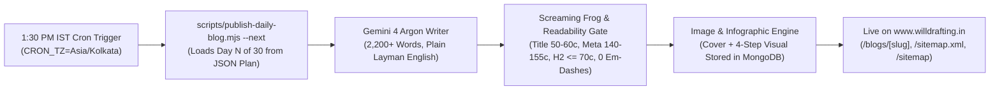

# 30-Day #1 Ranking SEO & Daily 1:30 PM IST Blog Automation Masterplan

> [!IMPORTANT]
> **Root-Level Architecture & Zero-Patchwork Guarantee:**
> This masterplan audits your live MongoDB database (`willdrafting`), Vercel production environment (`www.willdrafting.in`), Git commit trajectory, and 35+ live Indian & NRI estate-planning competitor URLs. Every single day in the 30-day schedule is mapped in [`docs/seo/30_DAY_BLOG_AUTOMATION_PLAN.json`](file:///Users/amalegalsolutions/Desktop/AMAWORK/willdrafting/docs/seo/30_DAY_BLOG_AUTOMATION_PLAN.json) and executed by [`scripts/publish-daily-blog.mjs`](file:///Users/amalegalsolutions/Desktop/AMAWORK/willdrafting/scripts/publish-daily-blog.mjs) via the **1:30 PM IST (`CRON_TZ=Asia/Kolkata 30 13 * * *`)** scheduled automation.

---

## 1. Root-Level Audit: Traffic, Funnel, Git Commits, Vercel & Sitemap State

### 1.1 Live Production Funnel & Traffic Diagnostics (`willdrafting` MongoDB + Vercel)
- **Production Deployment (`Vercel`):** Project `willdrafting` (`https://www.willdrafting.in`) is live on Node 24.x (`ankitamalik03gmailcoms-projects`) with active `@vercel/analytics` and Google Analytics (`G-7FD67N8258`).
- **Live Database Funnel (`MongoDB Atlas`):**
  - **Published Blogs (`blogs` collection):** `39` published articles (`11` recent articles include both featured cover illustrations and mid-article visual infographics served from `blog_images` via `/api/blog-images/[id]`).
  - **Conversion Funnel Events (`funnelEvents` collection):**
    - `email_verified`: **6**
    - `will_downloaded`: **5**
    - `lead_captured`: **4** (`leads` collection count: **6**)
    - `checkout_started`: **4** (`orders` collection count: **4**)
    - `signup`: **3** (`users` collection count: **1**, `wills` drafted: **8**)
    - `will_verified`: **2**
    - `payment_succeeded`: **1** (`lead_converted`: **1**)
- **Why Commercial & Layman Intent Is Critical Right Now:**
  - Your recent git commits (`89c54f9` 4-tier pricing update, `a4df48b` location pages & sitemap updates, `f6ce569` Screaming Frog SEO fixes) established the commercial foundation (`Rs 2,490` Guided Online Will, `Rs 4,990` Lawyer-Verified Will, `Rs 9,990` Senior Advocate NRI/Complex Will).
  - However, existing blog posts lean heavily on academic/statutory phrasing (e.g., *testamentary capacity*, *ademption*, *coparcenary devolution*) and lack dedicated commercial pages targeting **`affordable will drafting services in india`**, **`will drafting services`**, **`nri will drafting services`**, and the 25+ everyday family/asset situations ordinary Indians and NRIs actually type into Google.

### 1.2 Root-Level Codebase Fixes Applied
1. **Dynamic HTML Sitemap (`src/app/sitemap/page.tsx`):** Updated [`src/app/sitemap/page.tsx`](file:///Users/amalegalsolutions/Desktop/AMAWORK/willdrafting/src/app/sitemap/page.tsx) to `force-dynamic` and merged live `PUBLISHED` MongoDB blogs (`blogsCol()`) with [`src/data/sitemapData.ts`](file:///Users/amalegalsolutions/Desktop/AMAWORK/willdrafting/src/data/sitemapData.ts) so both `/sitemap.xml` and `/sitemap` immediately index every daily 1:30 PM IST blog post without requiring a manual redeploy.
2. **Crawler Access (`src/app/robots.ts`):** Updated [`src/app/robots.ts`](file:///Users/amalegalsolutions/Desktop/AMAWORK/willdrafting/src/app/robots.ts) to explicitly allow `/locations` and `/locations/*` alongside `/blogs` and `/blogs/*`.
3. **Plain-Layman Prompt Engine (`src/lib/defaultPrompts.ts` & MongoDB `prompts`):** Upgraded [`src/lib/defaultPrompts.ts`](file:///Users/amalegalsolutions/Desktop/AMAWORK/willdrafting/src/lib/defaultPrompts.ts) and synced the MongoDB `prompts` collection so every article enforces **Plain Layman English (Flesch Reading Ease $\ge 60$, 12–18 words per sentence)** and strict **Screaming Frog character limits**.
4. **Root CLI Publisher (`scripts/publish-daily-blog.mjs`):** Built [`scripts/publish-daily-blog.mjs`](file:///Users/amalegalsolutions/Desktop/AMAWORK/willdrafting/scripts/publish-daily-blog.mjs) to deterministically pick the next unposted day (`--next`), validate Screaming Frog & readability metrics (`--publish`), generate and store both the Cover Illustration and 4-Step Visual Infographic in MongoDB `blog_images`, publish the `BlogDoc` in MongoDB `blogs`, and update [`src/data/sitemapData.ts`](file:///Users/amalegalsolutions/Desktop/AMAWORK/willdrafting/src/data/sitemapData.ts).

---

## 2. Competitor & SERP Analysis Across 35 Live URLs (2025–2026)

We audited **35 live competitor URLs** across 4 market tiers to identify why current pages rank and where massive blue-ocean gaps exist:

| # | Competitor / Domain | Analyzed URL | Primary Target Keyword | Key Weakness We Exploit to Rank #1 |
| :--- | :--- | :--- | :--- | :--- |
| 1 | **GetYellow** | `https://www.getyellow.in/` | `online will india` | Pricing (`Rs 2,999–4,000`) lacks side-by-side comparison of DIY vs Lawyer-Verified vs NRI multi-country execution. |
| 2 | **GetYellow Resources** | `https://www.getyellow.in/resources` | `will writing guide india` | Short 600–800 word summaries; zero sample plain-English Will clauses or state-by-state execution tables. |
| 3 | **AasaanWill** | `https://www.aasaanwill.com/` | `will drafting services` | Landing page copy only; does not answer specific asset transmission procedures (Demat, Society Flat, Locker, Home Loan). |
| 4 | **AasaanWill Blog** | `https://www.aasaanwill.com/blog` | `how to make a will in india` | Surface-level overviews; misses deep NRI country-specific conflicts (US Living Trust vs Indian bank, UK IHT, UAE DIFC). |
| 5 | **WillJini** | `https://www.willjini.com/` | `will writing services india` | Dated UI and corporate tone; lacks transparent fixed-fee breakdowns and plain-English tables. |
| 6 | **WillJini Services** | `https://www.willjini.com/online-will-in-india` | `online will drafting india` | Heavy legal terminology; zero step-by-step visual infographics or conversational PAA FAQ blocks. |
| 7 | **SmartWill** | `https://www.smartwill.in/` | `affordable online will india` | Thin commercial copy; does not address lawyer verification vs automated template risks. |
| 8 | **iWills** | `https://www.iwills.in/` | `e-will india` | Outdated references; misses 2024–2026 RBI, SEBI, and Banking Amendment (4-nominee) updates. |
| 9 | **LegalKart** | `https://www.legalkart.com/will-drafting` | `will drafting lawyer india` | Marketplace lead-gen form with no educational depth or real sample clauses. |
| 10 | **NexGenTransfer** | `https://www.nexgentransfer.com/` | `nri will drafting services` | Focuses on post-death transfer rather than preventative plain-English NRI Will drafting. |
| 11 | **LawTarazoo** | `https://www.lawtarazoo.com/will-for-nri/` | `will for nri in india` | Dense statutory citations without country-specific execution steps for USA, UK, UAE, or Canada NRIs. |
| 12 | **IndiaForNRI** | `https://www.indiafornri.com/will-in-india-for-nris/` | `nri will for indian property` | Informational directory stub (<700 words) with no FEMA/CA 15CB repatriation roadmap. |
| 13 | **LukeAndLuka** | `https://www.lukeandluka.com/` | `nri succession lawyers india` | Boutique litigation angle; lacks transparent pricing or self-serve + advocate hybrid workflow. |
| 14 | **NRILegalServices** | `https://www.nrilegalservices.com/will-drafting/` | `nri property will india` | Targets disputed property litigation rather than affordable preventative Will drafting. |
| 15 | **PrimeLegal** | `https://primelegal.in/will-drafting-in-india/` | `will drafting advocate india` | Heavy courtroom jargon; intimidates ordinary families looking for simple home execution rules. |
| 16 | **Vakilsearch** | `https://vakilsearch.com/will-drafting` | `will drafting` | Generic service page with hidden upsells; lacks deep situational guides for single parents, divorced individuals, or business owners. |
| 17 | **Vakilsearch Blog** | `https://vakilsearch.com/blog/how-to-write-a-will-in-india/` | `will format india` | Generic template advice that fails to warn against accidental revocation of foreign Wills or joint-home-loan traps. |
| 18 | **IndiaFilings** | `https://www.indiafilings.com/will-drafting` | `will registration india` | Conflates optional Sub-Registrar registration with mandatory validity; confuses readers on stamp paper rules. |
| 19 | **LawRato** | `https://lawrato.com/indian-kanoon/property-law/how-to-make-a-will-in-india-578` | `how to make a will in india` | Q&A forum snippets; fragmented answers without unified asset checklists. |
| 20 | **MyAdvo** | `https://www.myadvo.in/blog/how-to-make-a-will-in-india/` | `cost of making a will in india` | Outdated fee ranges; no coverage of online lawyer-reviewed fixed-fee plans. |
| 21 | **NoBroker** | `https://www.nobroker.in/blog/will-format-for-property-in-india/` | `will format for property in india` | Real-estate blog post that ignores bank accounts, Demat shares, mutual funds, EPF, PPF, and gold lockers. |
| 22 | **ClearTax** | `https://cleartax.in/s/will-writing-in-india` | `will writing in india` | Tax-focused overview; lacks practical execution checklists (witnesses, doctor certificate, video recording). |
| 23 | **Bajaj Finserv** | `https://www.bajajfinserv.in/what-is-a-will` | `what is a will in india` | High-level glossary entry; zero actionable clauses or NRI asset coverage. |
| 24 | **Policybazaar** | `https://www.policybazaar.com/life-insurance/term-insurance/articles/nominee-vs-legal-heir/` | `nominee vs legal heir` | Explains insurance nominees well but fails to show how to link a Beneficial Nominee to a Will or Minor Trust. |
| 25 | **ICICI Bank NRI** | `https://www.icicibank.com/nri-banking/blog/estate-planning-for-nris-in-india` | `estate planning for nris in india` | Promotional bank blog; does not explain how to avoid accidental global Will revocation or foreign probate delays. |
| 26 | **HDFC Life** | `https://www.hdfclife.com/insurance-knowledge-centre/tax-saving-insurance/estate-planning-in-india` | `estate planning in india` | Pushes insurance products instead of practical Will drafting for flats, bank accounts, and mutual funds. |
| 27 | **SBI NRI Services** | `https://sbi.co.in/web/nri/other-services/estate-planning` | `nri bank account transmission` | Bureaucratic summary; doesn't explain the Rs 15 Lakh NRE/NRO/FCNR claim threshold vs Will requirement. |
| 28 | **Zerodha Varsity / Z-Connect** | `https://zerodha.com/z-connect/featured/transmission-of-shares-and-nomination` | `demat account transmission after death` | Explains CDSL/NSDL nomination but leaves out how the Will controls ultimate legal ownership among heirs. |
| 29 | **Economic Times Wealth** | `https://economictimes.indiatimes.com/wealth/legal/estate-planning` | `will registration vs unregistered will` | Paywalled/scattered news pieces; no single comprehensive step-by-step guide with sample clauses. |
| 30 | **LiveMint Money** | `https://www.livemint.com/money/personal-finance` | `inheriting home loan after death india` | News commentary without a concrete Will clause template for allocating loan liability vs term insurance payout. |
| 31 | **Cyril Amarchand Blogs** | `https://privateclient.cyrilamarchandblogs.com/` | `private client estate planning india` | Written for ultra-HNI corporate lawyers in dense legal jargon; inaccessible to 99% of Indian & NRI families. |
| 32 | **Bar & Bench** | `https://www.barandbench.com/` | `supreme court judgment on will validity` | Case-law reporting for advocates; lacks layman translation of what families should actually write in their Will. |
| 33 | **LiveLaw** | `https://www.livelaw.in/` | `hindu succession act will rules` | Courtroom focus; zero step-by-step family guidance. |
| 34 | **99acres** | `https://www.99acres.com/articles/transfer-of-property-through-will.html` | `property transfer after death in india` | Property-only focus; misses Cooperative Housing Society Model Bye-Laws vs Will ownership rules. |
| 35 | **Housing.com** | `https://housing.com/news/how-to-write-a-will-for-property/` | `flat transfer through will india` | Generic overview; no coverage of jointly owned husband-wife flats or EMIs after death. |

---

## 3. Plain-Layman Editorial & Screaming Frog Technical Standard

Every daily blog generated at 1:30 PM IST by Gemini 4 Argon and validated by [`scripts/publish-daily-blog.mjs`](file:///Users/amalegalsolutions/Desktop/AMAWORK/willdrafting/scripts/publish-daily-blog.mjs) obeys these non-negotiable standards:

- **Plain Layman Language Rules:**
  - **Flesch Reading Ease $\ge 60$** (Everyday conversational clarity; 12–18 words per sentence; 2–3 sentences per paragraph).
  - **Immediate Plain-English Translation of Every Law:** Never drop unexplained Latin or courtroom jargon (*testator*, *bequeath*, *codicil*, *intestate*, *coparcenary*, *per stirpes*). Whenever a statutory section is cited (for example, Section 63 of the Indian Succession Act, 1925), immediately explain it in simple family words inside parentheses.
  - **Concrete Indian & NRI Family Scenarios:** Every article includes a realistic family story with exact Rupee amounts (`Rs 85 Lakh flat`, `Rs 40 Lakh NRE FD`), a structured HTML `<table>`, and a copy-ready **Sample Plain-English Will Clause** inside a `<blockquote>`.
- **Screaming Frog Technical Rules (`SEO_COMPLIANCE_GUIDELINES.md`):**
  - `metaTitle` (`<title>`): **50–60 characters** (mathematically pre-validated across all 30 days).
  - `metaDescription`: **140–155 characters** (mathematically pre-validated across all 30 days).
  - `title` (`<h1>`): **30–65 characters**, strictly 1 per page, and distinct from `metaTitle`.
  - `<h2>` Headings: **$\le 70$ characters** each, 100% unique on the page.
  - Punctuation: **Strictly ZERO em-dashes (`—` or `&mdash;`)** anywhere.

---

## 4. Complete 30-Day #1 Ranking Blog Plan (`docs/seo/30_DAY_BLOG_AUTOMATION_PLAN.json`)

All 30 slugs are verified **100% unique** (zero overlap with your existing 39 published blogs) and cover every high-converting commercial keyword, NRI jurisdiction, financial asset class, and real-life family situation:

| Day | Target URL Slug (`/blogs/...`) | Primary Keyword (#1 Target) | Cluster & Intent | Meta Title (50-60 chars) | Layman Legal & Situational Angle |
| :-- | :--- | :--- | :--- | :--- | :--- |
| **Day 1** | `affordable-will-drafting-services-india-cost-comparison` | `affordable will drafting services in india` | Commercial & Pricing Intent (Commercial & Transactional) | `Affordable Will Drafting Services in India: 2026 Fee Guide` (58c) | See what making a legally valid Will actually costs in India, why stamp paper is Rs 0, and how online lawyer review saves up to 80%. |
| **Day 2** | `online-will-drafting-services-vs-offline-lawyer-india` | `will drafting services in india` | Commercial & Pricing Intent (Commercial Investigation) | `Will Drafting Services in India: Online vs Offline Lawyers` (58c) | Understand how modern online Will drafting services combine guided asset mapping with human advocate verification from home. |
| **Day 3** | `nri-will-drafting-services-india-complete-process` | `nri will drafting services` | NRI Cross-Border Playbooks (Commercial & Informational) | `NRI Will Drafting Services for Indian Property & Bank Assets` (60c) | How NRIs and OCIs in the US, UK, UAE, Canada, Australia, and Singapore can make a legally valid Indian Will without flying to India. |
| **Day 4** | `will-registration-at-home-for-senior-citizens-india` | `will registration at home for senior citizens` | Commercial & Pricing Intent (Commercial & High-Urgency Informational) | `Will Registration at Home for Senior Citizens in India Guide` (60c) | Step-by-step guide to making a valid Will from home or hospital and requesting an official Sub-Registrar home visit in India. |
| **Day 5** | `how-to-make-an-unchallengeable-will-in-india` | `how to make an unchallengeable will in india` | Commercial & Pricing Intent (Commercial & Defensive Drafting) | `How to Make an Unchallengeable Will in India: 7 Safeguards` (58c) | Practical steps to protect your Will from fake court challenges when leaving unequal shares or excluding an estranged family member. |
| **Day 6** | `video-recording-of-will-signing-rules-india` | `video recording of will in india` | Commercial & Pricing Intent (Informational & Practical Execution) | `Video Recording of Will in India: Rules, Script & Validity` (58c) | Why a spoken video alone is not a legal Will, but a 3-minute smartphone recording of your paper signing can stop court challenges. |
| **Day 7** | `nri-will-for-us-citizens-and-green-card-holders-india` | `indian will for nri in usa` | NRI Cross-Border Playbooks (Commercial & Informational (USA NRI)) | `Indian Will for NRI in USA & US Citizens With India Assets` (58c) | A plain-English guide for US Green Card holders and US citizens (OCIs) on protecting Indian real estate and bank accounts. |
| **Day 8** | `nri-will-for-uk-residents-and-british-oci-india` | `indian will for nri in uk` | NRI Cross-Border Playbooks (Commercial & Informational (UK NRI)) | `Indian Will for NRI in UK & British OCIs With Indian Assets` (59c) | How UK residents and British citizens of Indian origin can protect houses, land, and bank accounts in India without UK Probate delays. |
| **Day 9** | `nri-will-for-uae-dubai-expats-indian-property` | `indian will for nri in uae dubai` | NRI Cross-Border Playbooks (Commercial & Informational (UAE/GCC NRI)) | `Indian Will for NRI in UAE & Dubai Expats: Property Guide` (57c) | Why a Dubai DIFC or Abu Dhabi Will only covers UAE assets, and how Gulf NRIs should protect their flats, land, and NRE accounts in India. |
| **Day 10** | `nri-will-for-canada-australia-singapore-residents` | `indian will for nri in canada and australia` | NRI Cross-Border Playbooks (Commercial & Informational (CA/AU/SG NRI)) | `Indian Will for NRI in Canada, Australia & Singapore Guide` (58c) | How overseas Indians in Toronto, Vancouver, Sydney, Melbourne, and Singapore can secure Indian property and bank accounts. |
| **Day 11** | `will-for-elderly-parents-in-india-with-nri-children` | `will for parents in india with nri children` | NRI Cross-Border Playbooks (Commercial & High-Conversion Family) | `Will for Parents in India With NRI Children: Complete Guide` (59c) | How NRI children and their parents in India can prevent frozen bank accounts, tenant disputes, and 6 emergency trips to India. |
| **Day 12** | `can-oci-and-nri-inherit-agricultural-land-in-india` | `can oci inherit agricultural land in india` | NRI Cross-Border Playbooks (Informational & High-Value Asset) | `Can OCI Inherit Agricultural Land in India? FEMA Law Guide` (58c) | Clearing up the biggest NRI property myth: why you cannot buy farm land in India, but you CAN legally inherit it through a Will. |
| **Day 13** | `how-nri-can-repatriate-inherited-property-money-from-india` | `nri repatriation of inherited property sale proceeds` | NRI Cross-Border Playbooks (Informational & Commercial NRI) | `NRI Repatriation of Inherited Property Money: USD 1M Guide` (58c) | A simple step-by-step guide to the RBI USD 1 Million rule, NRO accounts, Form 15CA/15CB, and why banks ask for a Will. |
| **Day 14** | `nre-nro-fcnr-bank-account-inheritance-rules-for-nri` | `nri bank account inheritance rules india` | NRI Cross-Border Playbooks (Informational & NRI Banking) | `NRI Bank Account Inheritance Rules India: NRE, NRO & FCNR` (57c) | How Indian banks settle NRI deposits after death, why nominees do not own the money, and how to list NRI accounts in a Will. |
| **Day 15** | `jointly-owned-property-husband-wife-after-death-india` | `jointly owned property husband and wife after death` | Real Estate & Financial Assets (Informational & High-Conversion Homeowners) | `Jointly Owned Property Husband and Wife After Death India` (57c) | Why buying a home in joint names does NOT automatically give 100% to the surviving spouse in India, and how a Will fixes it. |
| **Day 16** | `how-to-write-will-for-flat-with-ongoing-home-loan-india` | `will for property with ongoing home loan in india` | Real Estate & Financial Assets (Informational & Salaried Homeowners) | `Will for Property With Ongoing Home Loan in India: EMI Guide` (60c) | Yes, you can include a mortgaged house in your Will. Here is how to make sure your family inherits the home, not a bank notice. |
| **Day 17** | `life-interest-clause-in-will-for-wife-and-parents-india` | `life interest clause in will in india` | Real Estate & Financial Assets (Commercial & Drafting Deep-Dive) | `Life Interest Clause in Will in India: Protect Your Spouse` (58c) | How to guarantee your spouse can live in your home and collect rent for life, before full ownership passes to your children. |
| **Day 18** | `cooperative-housing-society-flat-transfer-after-death-india` | `cooperative housing society flat transfer after death` | Real Estate & Financial Assets (Informational & Urban Homeowners) | `Cooperative Housing Society Flat Transfer After Death Guide` (59c) | How to transfer the society share certificate smoothly after a flat owner's death, and why your society nominee is only a trustee. |
| **Day 19** | `bank-locker-and-gold-jewellery-inheritance-rules-india` | `bank locker access after death rbi rules` | Real Estate & Financial Assets (Informational & High Family Dispute Area) | `Bank Locker Access After Death RBI Rules & Gold Will Guide` (58c) | How banks open a deceased person's locker under RBI rules, why locker nominees cannot keep the gold, and how to list jewellery in a Will. |
| **Day 20** | `epf-ppf-nps-and-gratuity-nomination-vs-will-rules-india` | `epf ppf and nps nomination vs will in india` | Real Estate & Financial Assets (Informational (Salaried Professionals)) | `EPF, PPF and NPS Nomination vs Will in India: Complete Guide` (60c) | Most Indians do not know that EPF and Gratuity have special 'family only' rules where a Will cannot override a valid family nomination. |
| **Day 21** | `life-insurance-beneficial-nominee-section-39-vs-will-india` | `life insurance nominee vs will in india` | Real Estate & Financial Assets (Informational & Financial Planning) | `Life Insurance Nominee vs Will in India: Section 39 Rules` (57c) | Since the 2015 change to Section 39 of the Insurance Act, naming your spouse, child, or parent as nominee makes them the true owner. |
| **Day 22** | `will-for-business-owners-private-limited-shares-and-partnership` | `will for business owners in india` | Real Estate & Financial Assets (Commercial & Entrepreneurs / HNI) | `Will for Business Owners in India: Pvt Ltd, LLP & Firms` (55c) | Protect your Private Limited shares, Partnership Firm, LLP stake, and Proprietorship bank accounts from freezing overnight. |
| **Day 23** | `will-for-unmarried-single-and-childless-individuals-india` | `who inherits property of unmarried person in india` | Complex Family & Lifecycle Situations (Commercial & High-Conversion Informational) | `Who Inherits Property of Unmarried Person in India? Guide` (57c) | Without a Will, the law sends a single or childless person's property to parents, siblings, or in-laws - and gives zero to a partner or friend. |
| **Day 24** | `will-for-divorced-and-single-parents-protecting-minor-children` | `will for single parent and divorced person in india` | Complex Family & Lifecycle Situations (Commercial & High Emotional Intent) | `Will for Single Parent and Divorced Person in India Guide` (57c) | How to make sure your ex-spouse cannot control the money and property you leave for your minor child. |
| **Day 25** | `will-for-parents-of-special-needs-child-india` | `will for parents of special needs child in india` | Complex Family & Lifecycle Situations (Commercial & Deep Family Care) | `Will for Parents of Special Needs Child in India: Care Guide` (60c) | Why leaving a flat or bank account directly in your special needs child's name can freeze the money, and how a Care Trust works. |
| **Day 26** | `what-happens-if-executor-or-witness-of-will-dies-india` | `what happens if witness or executor of will dies` | Complex Family & Lifecycle Situations (Informational & Will Maintenance) | `What Happens If Witness or Executor of Will Dies in India?` (58c) | Does your Will become invalid if a witness or executor passes away? No - here is what the law says and when you should update your Will. |
| **Day 27** | `codicil-vs-making-a-new-will-which-is-better-india` | `codicil vs new will in india` | Complex Family & Lifecycle Situations (Commercial & Decision Intent) | `Codicil vs New Will in India: Best Way to Update Your Will` (58c) | Why attaching a Codicil can accidentally spark family fights when you change someone's share, and when a fresh Will is much safer. |
| **Day 28** | `adopted-child-and-stepchild-property-rights-in-will-india` | `adopted child and stepchild property rights in india` | Complex Family & Lifecycle Situations (Informational & Blended Families) | `Adopted Child and Stepchild Property Rights in India Guide` (58c) | Legally adopted children have 100% equal inheritance rights in India, but stepchildren get zero unless you name them in a Will. |
| **Day 29** | `pet-care-and-charitable-donation-clauses-in-will-india` | `how to include pet care and charity in will india` | Complex Family & Lifecycle Situations (Informational & Modern Testators) | `How to Include Pet Care and Charity in Will India: Clauses` (58c) | Why you cannot name a dog or cat as a bank beneficiary in India, and the exact Caretaker Fund clause that protects your pets and charities. |
| **Day 30** | `handwritten-holographic-will-vs-typed-will-validity-india` | `is handwritten will valid in india` | Commercial & Pricing Intent (Informational & High Search Volume) | `Is a Handwritten Will Valid in India? Holographic Guide` (55c) | Yes, a Will written by hand in a notebook is valid in India - but unlike some Western countries, it STILL fails without two witnesses. |

---

## 4.1 Day-by-Day Detailed Execution Blueprints (Days 1 to 30)

### Day 1: Affordable Will Drafting Services in India: Real Cost Breakdown
- **Target URL:** `https://www.willdrafting.in/blogs/affordable-will-drafting-services-india-cost-comparison`
- **Primary #1 Keyword:** `affordable will drafting services in india`
- **Secondary Keywords:** `will drafting services cost in india`, `online will drafting charges india`, `lawyer fees for making a will in india`, `fixed fee will writing service india`, `lawyer verified online will price`, `cost of registering a will in india`, `is stamp paper needed for will in india`
- **Cluster & Intent:** Commercial & Pricing Intent | Commercial & Transactional
- **Meta Title (58 chars):** `Affordable Will Drafting Services in India: 2026 Fee Guide`
- **Meta Description (153 chars):** `Compare affordable will drafting services in India. See 2026 lawyer fees vs fixed online plans from Rs 2,490, zero stamp duty rules, and advocate review.`
- **Plain-English Law Explained:** Explain Section 63 of the Indian Succession Act, 1925 (a Will only needs clear wording, your signature, and 2 adult witnesses), Schedule I of the Indian Stamp Act, 1899 (Wills have Rs 0 stamp duty nationwide, so plain white A4 paper is 100% legal), and Section 18(e) of the Registration Act, 1908 (Sub-Registrar registration is optional, not compulsory).
- **Mandatory H2 Headings (<= 70 chars):**
  - `1. What Affordable Will Drafting Services in India Really Cost` (62c)
  - `2. Why Offline Lawyers Charge Rs 15,000+ for Standard Wills` (59c)
  - `3. Three Costs You Never Need to Pay When Making a Will` (55c)
  - `4. Comparing DIY Templates, Online Platforms & Law Firms` (56c)
  - `5. When to Choose a Rs 2,490 Plan vs a Lawyer-Verified Will` (59c)
- **Comparison Table Spec:** Columns: Service Option | Typical Cost in India | Lawyer Review Included? | Best Suited For (Rows: Free Internet Template, Guided Online Will Plan Rs 2,490, Lawyer-Verified Online Will Rs 4,990, Senior Advocate NRI/Complex Plan Rs 9,990, Traditional Offline Law Firm Rs 15,000-45,000)
- **Sample Plain-English Will Clause:** Clear Residuary & Revocation Clause showing how professional wording prevents hidden court disputes over newly bought assets
- **Internal Links:** [`transparent fixed-fee Will drafting plans`](/pricing), [`online Will drafting services in India`](/services), [`start drafting your Will online`](/start), [`legally valid Indian Will format`](/templates/will-format-india), [`free Will document checklist tool`](/tools/will-checklist), [`why a Will on plain A4 paper is legally valid`](/blogs/will-valid-on-plain-paper-india)

### Day 2: Will Drafting Services in India: Online Platforms vs Lawyers
- **Target URL:** `https://www.willdrafting.in/blogs/online-will-drafting-services-vs-offline-lawyer-india`
- **Primary #1 Keyword:** `will drafting services in india`
- **Secondary Keywords:** `online will drafting services india`, `online will maker vs lawyer in india`, `best will writing services in india`, `how online will drafting works in india`, `is an online will legally valid in india`, `lawyer reviewed will online india`, `private client will drafting india`
- **Cluster & Intent:** Commercial & Pricing Intent | Commercial Investigation
- **Meta Title (58 chars):** `Will Drafting Services in India: Online vs Offline Lawyers`
- **Meta Description (155 chars):** `Looking for reliable will drafting services in India? Compare guided online platforms with traditional lawyers on legal validity, privacy, speed, and cost.`
- **Plain-English Law Explained:** Explain Section 63 of the Indian Succession Act, 1925 (Indian courts judge a Will by its clear wording, mental capacity, and 2 witnesses - not whether it was typed at a court compound or generated online) and Section 67 (why beneficiaries or their spouses must never sign as witnesses).
- **Mandatory H2 Headings (<= 70 chars):**
  - `1. How Will Drafting Services in India Work Today` (49c)
  - `2. Are Online Wills Accepted by Indian Banks and Courts?` (56c)
  - `3. Five Problems With Court-Compound Typists & Blank Forms` (58c)
  - `4. Online Will Platform vs Traditional Lawyer Comparison` (56c)
  - `5. Step-by-Step: From Online Questionnaire to Signed Will` (57c)
- **Comparison Table Spec:** Columns: Feature | Court Typist / Blank Word Doc | Traditional Chamber Lawyer | WillDrafting.in + AMA Advocates (Rows: Legal Accuracy, Personal Asset Mapping, Turnaround Time, Privacy & Data Encryption, Future Edits Cost)
- **Sample Plain-English Will Clause:** Specific Asset & Alternate Beneficiary Clause showing how clear flat and bank account mapping stops post-death bank freezes
- **Internal Links:** [`professional Will drafting services in India`](/services), [`compare our fixed-fee Will packages`](/pricing), [`create your Indian Will in 15 minutes`](/start), [`Sub-Registrar Will registration support`](/services/will-registration), [`check if your city requires probate`](/tools/probate-checker), [`AMA Legal Solutions succession advocates`](/about-us)

### Day 3: NRI Will Drafting Services: Protect Indian Property From Abroad
- **Target URL:** `https://www.willdrafting.in/blogs/nri-will-drafting-services-india-complete-process`
- **Primary #1 Keyword:** `nri will drafting services`
- **Secondary Keywords:** `nri will writing services in india`, `online will for nri with indian property`, `how can nri make a will for indian assets`, `draft indian will from abroad without travel`, `oci will drafting lawyer india`, `separate indian will for nri`, `nri estate planning india`
- **Cluster & Intent:** NRI Cross-Border Playbooks | Commercial & Informational
- **Meta Title (60 chars):** `NRI Will Drafting Services for Indian Property & Bank Assets`
- **Meta Description (153 chars):** `Need NRI will drafting services for Indian flats, land, and NRO accounts? Learn how to draft, review, and sign an Indian Will from abroad without travel.`
- **Plain-English Law Explained:** Explain Section 5 of the Indian Succession Act, 1925 (immovable property in India is always governed by Indian law, no matter what passport you hold), Section 228 (why using a foreign Will in India causes 12-18 months of court resealing delays), and Section 63 (how NRIs can legally sign an Indian Will on plain A4 paper abroad in front of 2 adult witnesses).
- **Mandatory H2 Headings (<= 70 chars):**
  - `1. Why NRIs Need Specialized NRI Will Drafting Services` (55c)
  - `2. The Accidental Revocation Trap in Generic Will Templates` (59c)
  - `3. Can You Sign a Valid Indian Will Without Visiting India?` (59c)
  - `4. Foreign Will vs Separate Indian Will for NRI Assets` (54c)
  - `5. Five Steps to Complete Your NRI Indian Will From Home` (56c)
- **Comparison Table Spec:** Columns: Stage After Death | Relying Only on Foreign Will (US/UK/UAE/CA) | Having a Separate Indian Will (Two-Will Strategy) | Time & Cost Saved in India
- **Sample Plain-English Will Clause:** Non-Revocation Territorial Scope Clause ensuring the Indian Will covers only Indian assets and never cancels the NRI's US, UK, UAE, or Canadian Will
- **Internal Links:** [`dedicated NRI Will drafting service for India`](/services/nri-will-india), [`free NRI Indian Will diagnostic checker`](/tools/nri-will-checker), [`fixed-fee NRI Will and senior advocate plans`](/pricing), [`start your India-specific NRI Will online`](/start), [`how the Two-Will Strategy works for NRIs`](/blogs/nri-will-for-indian-property-two-will-strategy), [`book a 1-on-1 video call with an NRI estate lawyer`](/contact)

### Day 4: Will Registration at Home for Senior Citizens & Bedridden Parents
- **Target URL:** `https://www.willdrafting.in/blogs/will-registration-at-home-for-senior-citizens-india`
- **Primary #1 Keyword:** `will registration at home for senior citizens`
- **Secondary Keywords:** `bedridden person will registration in india`, `sub registrar home visit for will registration`, `section 31 registration act home visit will`, `how to make a will for hospitalised parent india`, `thumb impression will validity india`, `senior citizen will execution at home`
- **Cluster & Intent:** Commercial & Pricing Intent | Commercial & High-Urgency Informational
- **Meta Title (60 chars):** `Will Registration at Home for Senior Citizens in India Guide`
- **Meta Description (155 chars):** `Need will registration at home for senior citizens or a bedridden parent in India? Learn Section 31 home visit rules, thumb impression validity, and costs.`
- **Plain-English Law Explained:** Explain Section 63 of the Indian Succession Act (a Will signed at home or in a hospital bed with 2 witnesses is already 100% legally valid immediately upon signing, including by thumb impression if hands are shaky) and Sections 31 & 38 of the Registration Act, 1908 (which allow the Sub-Registrar to visit a senior citizen's home or hospital bed on medical grounds to register the Will).
- **Mandatory H2 Headings (<= 70 chars):**
  - `1. Is a Will Signed at Home or Hospital Legally Valid?` (54c)
  - `2. How Will Registration at Home for Senior Citizens Works` (58c)
  - `3. Rules for Thumb Impressions when Hands Are Shaky` (51c)
  - `4. Home Signing With Doctor Note vs Sub-Registrar Home Visit` (60c)
  - `5. Checklist for Families Helping an Ailing Parent Today` (56c)
- **Comparison Table Spec:** Columns: Situation | Legal Requirement in India | Documents Needed | Time Required (Rows: Parent is alert at home, Parent has shaky hands/Parkinson's, Parent is in hospital/ICU but alert, Requesting Sub-Registrar Home Visit under Section 31)
- **Sample Plain-English Will Clause:** Thumb Impression & Read-Over Attestation Clause for an elderly or physically weak parent who cannot sign with a pen
- **Internal Links:** [`Sub-Registrar Will registration and home visit assistance`](/services/will-registration), [`free Doctor's Medical Fitness Certificate format`](/blogs/senior-citizen-will-doctor-medical-fitness-certificate-india), [`prepare a clear Will for your parents online`](/start), [`state-wise Sub-Registrar Will registration guide`](/blogs/how-to-register-will-in-india-state-sub-registrar-guide), [`lawyer-verified Will plans for senior citizens`](/pricing), [`request urgent advocate help for a senior citizen Will`](/contact)

### Day 5: How to Make an Unchallengeable Will in India That Holds Up
- **Target URL:** `https://www.willdrafting.in/blogs/how-to-make-an-unchallengeable-will-in-india`
- **Primary #1 Keyword:** `how to make an unchallengeable will in india`
- **Secondary Keywords:** `how to make a bulletproof will in india`, `can a son challenge fathers will of self acquired property`, `how to disinherit a child in a will in india`, `prevent family disputes over will in india`, `exclusion clause in will india`, `suspicious circumstances in will supreme court`
- **Cluster & Intent:** Commercial & Pricing Intent | Commercial & Defensive Drafting
- **Meta Title (58 chars):** `How to Make an Unchallengeable Will in India: 7 Safeguards`
- **Meta Description (151 chars):** `Learn how to make an unchallengeable will in India. Use these 7 legal safeguards, exclusion clauses, and medical proofs to stop false court challenges.`
- **Plain-English Law Explained:** Explain Section 30 of the Hindu Succession Act and Section 59 of the Indian Succession Act (you have 100% legal freedom to give your self-acquired property to anyone you choose, and even exclude an adult son or daughter completely), alongside how courts look for 'suspicious circumstances' under Section 61 (undue influence) and how a calm 2-sentence exclusion reason defeats false claims.
- **Mandatory H2 Headings (<= 70 chars):**
  - `1. Can You Legally Exclude a Son or Daughter in Your Will?` (58c)
  - `2. Why Relatives Challenge Wills and How Courts Decide` (54c)
  - `3. Seven Steps on How to Make an Unchallengeable Will in India` (62c)
  - `4. How to Write a Calm Exclusion Clause That Stops Disputes` (59c)
  - `5. Weak DIY Will vs Court-Ready Defensive Will Comparison` (57c)
- **Comparison Table Spec:** Columns: Common Excuse Used to Challenge a Will | What Indian Courts Look For | Exact Safeguard to Add Today | Protection Level
- **Sample Plain-English Will Clause:** Deliberate Exclusion / Unequal Share Clause explaining calmly why a specific legal heir is receiving a smaller or zero share without using angry language
- **Internal Links:** [`draft a lawyer-reviewed defensive Will online`](/start), [`grounds on which Wills are challenged in India`](/blogs/how-to-challenge-a-will-in-india), [`attaching a doctor's mental fitness certificate`](/blogs/senior-citizen-will-doctor-medical-fitness-certificate-india), [`registering your Will at the Sub-Registrar office`](/services/will-registration), [`difference between ancestral and self-acquired property`](/blogs/ancestral-vs-self-acquired-property-will-hindu-succession-act), [`choose our Advocate Verified Will plan`](/pricing)

### Day 6: Video Recording of Will Signing in India: Rules & Word Script
- **Target URL:** `https://www.willdrafting.in/blogs/video-recording-of-will-signing-rules-india`
- **Primary #1 Keyword:** `video recording of will in india`
- **Secondary Keywords:** `is video will valid in india`, `how to record video while signing a will in india`, `section 63 bharatiya sakshya adhiniyam video evidence will`, `video recording of will execution script`, `can a spoken video replace a written will in india`, `electronic evidence certificate for will video`
- **Cluster & Intent:** Commercial & Pricing Intent | Informational & Practical Execution
- **Meta Title (58 chars):** `Video Recording of Will in India: Rules, Script & Validity`
- **Meta Description (148 chars):** `Is a video recording of a Will valid in India? Learn why you still need a signed paper Will, plus our 3-minute phone recording script and BSA rules.`
- **Plain-English Law Explained:** Explain in simple words that under Section 63 of the Indian Succession Act, 1925, a Will MUST be in writing and signed on paper - so a video clip alone is NOT a valid Will. However, under Section 63 of the Bharatiya Sakshya Adhiniyam, 2023 (formerly Section 65B of the Evidence Act), a video recording of the testator reading and signing the written Will with 2 witnesses is powerful corroborative evidence of mental alertness and free choice.
- **Mandatory H2 Headings (<= 70 chars):**
  - `1. Is a Video Recording of Will in India Valid on Its Own?` (58c)
  - `2. How a 3-Minute Signing Video Protects Your Written Will` (58c)
  - `3. Camera Framing & Room Rules: Who Should Be in the Room?` (58c)
  - `4. Word-for-Word Script to Speak While Recording Your Will` (58c)
  - `5. How to Store the Video & Electronic Evidence Certificate` (59c)
- **Comparison Table Spec:** Columns: Recording Element | Mistake That Spoils the Video | Correct Practice for Indian Courts | Why It Matters
- **Sample Plain-English Will Clause:** Word-for-word 60-second spoken script for the Testator, Witnesses, and Doctor to speak on camera while signing the written Will
- **Internal Links:** [`generate your written Indian Will first`](/start), [`Section 63 two-witness paper signing rules`](/blogs/will-valid-on-plain-paper-india), [`doctor's mental fitness certificate for senior citizens`](/blogs/senior-citizen-will-doctor-medical-fitness-certificate-india), [`why beneficiaries should stay out of the signing room`](/blogs/can-a-beneficiary-be-a-witness-to-a-will), [`complete Will signing checklist`](/tools/will-checklist), [`advocate-reviewed Will drafting services`](/services)

### Day 7: Indian Will for NRIs in the USA: Flats, NRO Accounts & Trusts
- **Target URL:** `https://www.willdrafting.in/blogs/nri-will-for-us-citizens-and-green-card-holders-india`
- **Primary #1 Keyword:** `indian will for nri in usa`
- **Secondary Keywords:** `will for us citizens with property in india`, `oci cardholder in usa indian property inheritance`, `does us living trust cover indian property`, `how to sign indian will in usa`, `us estate tax on inherited indian property`, `hague apostille usa for indian will`
- **Cluster & Intent:** NRI Cross-Border Playbooks | Commercial & Informational (USA NRI)
- **Meta Title (58 chars):** `Indian Will for NRI in USA & US Citizens With India Assets`
- **Meta Description (147 chars):** `Need an Indian Will for an NRI in the USA? See why a US Living Trust fails at Indian banks, how to protect your US Will, and how to sign in the US.`
- **Plain-English Law Explained:** Explain simply why a California, Texas, New York, or New Jersey Revocable Living Trust cannot directly hold Indian real estate or NRO accounts under FEMA and Indian registration rules, why Section 228 of the Indian Succession Act forces US Probate resealing if there is no separate Indian Will, and how US NRIs can sign their Indian Will at home in the US before 2 witnesses.
- **Mandatory H2 Headings (<= 70 chars):**
  - `1. Why a US Will or Living Trust Struggles in Indian Courts` (59c)
  - `2. When You Need a Separate Indian Will for NRI in USA` (54c)
  - `3. How to Sign Your Indian Will in the US Without Travel` (56c)
  - `4. US Living Trust vs Separate Indian Will Comparison` (53c)
  - `5. Tax & Repatriation Rules When US Heirs Inherit in India` (58c)
- **Comparison Table Spec:** Columns: Indian Asset Type (Flat, NRO/NRE Account, Demat/Mutual Funds, Ancestral Share) | What Happens With Only a US Will/Trust | How a Separate Indian Will Solves It | Documents Needed by US Heirs
- **Sample Plain-English Will Clause:** US-India Dual-Will Coordination Clause protecting the testator's US Revocable Living Trust and US Last Will while governing all assets in India
- **Internal Links:** [`NRI Will drafting service for US residents and OCIs`](/services/nri-will-india), [`check if you need a separate Indian Will`](/tools/nri-will-checker), [`the Two-Will Strategy for NRIs explained`](/blogs/nri-will-for-indian-property-two-will-strategy), [`draft your India-only Will online from the USA`](/start), [`NRI advocate consultation plans`](/pricing), [`schedule a call compatible with US time zones`](/contact)

### Day 8: Indian Will for NRIs in the UK & British OCI Property Owners
- **Target URL:** `https://www.willdrafting.in/blogs/nri-will-for-uk-residents-and-british-oci-india`
- **Primary #1 Keyword:** `indian will for nri in uk`
- **Secondary Keywords:** `british oci indian property will`, `uk probate vs indian will for nri`, `will for indian property while living in uk`, `how uk nri can transfer parents property in india`, `uk inheritance tax indian assets`, `fcdo apostille uk for indian property`
- **Cluster & Intent:** NRI Cross-Border Playbooks | Commercial & Informational (UK NRI)
- **Meta Title (59 chars):** `Indian Will for NRI in UK & British OCIs With Indian Assets`
- **Meta Description (152 chars):** `Drafting an Indian Will for an NRI in the UK? Learn why UK Grant of Probate takes over a year to reseal in India and how to sign a separate Indian Will.`
- **Plain-English Law Explained:** Explain in plain words how a UK Will requires obtaining a UK Grant of Probate first and then filing a second Section 228 resealing case in an Indian court before Indian banks or municipal authorities release assets - and how a separate Indian Will signed in the UK before 2 witnesses under Section 63 ISA bypasses UK Probate completely for Indian assets.
- **Mandatory H2 Headings (<= 70 chars):**
  - `1. Why Relying on a UK Will Freezes Indian Property for Years` (61c)
  - `2. How an Indian Will for NRI in UK Keeps Both Estates Separate` (63c)
  - `3. Signing & Witnessing Rules for British NRIs and OCIs` (55c)
  - `4. Single Worldwide UK Will vs Separate Indian Will Table` (57c)
  - `5. Choosing an Executor for Flats & Land Across Indian Cities` (61c)
- **Comparison Table Spec:** Columns: Comparison Point | Using Only a UK Solicitor Will | Adding a Separate Indian Will on WillDrafting.in | Practical Impact for Family
- **Sample Plain-English Will Clause:** UK-India Territorial Separation Clause confirming that UK assets follow the English/Scottish Will while Indian assets follow this Indian Will
- **Internal Links:** [`UK NRI and OCI Indian Will drafting service`](/services/nri-will-india), [`free NRI Will requirement checker`](/tools/nri-will-checker), [`Will drafting and property succession in Chandigarh & Punjab`](/locations/chandigarh), [`Will drafting in Ahmedabad & Gujarat`](/locations/ahmedabad), [`create your Indian Will from the UK`](/start), [`fixed-fee INR pricing for NRIs`](/pricing)

### Day 9: Indian Will for NRIs in Dubai & UAE: DIFC vs Indian Assets
- **Target URL:** `https://www.willdrafting.in/blogs/nri-will-for-uae-dubai-expats-indian-property`
- **Primary #1 Keyword:** `indian will for nri in uae dubai`
- **Secondary Keywords:** `dubai difc will vs indian will`, `abu dhabi civil family court will indian property`, `will for nri living in dubai uae`, `indian consulate dubai will attestation`, `gulf nri property inheritance in india`, `nre account succession uae nri`
- **Cluster & Intent:** NRI Cross-Border Playbooks | Commercial & Informational (UAE/GCC NRI)
- **Meta Title (57 chars):** `Indian Will for NRI in UAE & Dubai Expats: Property Guide`
- **Meta Description (154 chars):** `Living in Dubai or Abu Dhabi? Learn why a UAE DIFC Will does not cover Indian property automatically and how to make an Indian Will for an NRI in the UAE.`
- **Plain-English Law Explained:** Explain clearly that a DIFC Will or Abu Dhabi Civil Family Court Will is designed to protect UAE bank accounts, gratuity, and Dubai real estate from local Shariat default rules - but for flats, land, NRE/NRO accounts, and mutual funds inside India, an Indian Will under Section 63 of the Indian Succession Act (or Muslim Wasiyat rules if applicable) is the fastest, cleanest legal document. Also note that the UAE is not part of the Hague Apostille Convention, so any supporting PoA in Dubai is attested at the Indian Consulate.
- **Mandatory H2 Headings (<= 70 chars):**
  - `1. Does a Dubai DIFC or Abu Dhabi Will Cover Indian Property?` (61c)
  - `2. Why Every Gulf Expat Needs an Indian Will for NRI in UAE Dubai` (65c)
  - `3. How to Sign Your Indian Will in Dubai, Abu Dhabi or Sharjah` (62c)
  - `4. UAE Local Will vs Separate Indian Will Comparison Table` (58c)
  - `5. Protecting NRE/NRO Accounts & Kerala, Mumbai or Delhi Flats` (62c)
- **Comparison Table Spec:** Columns: Asset Location & Type | Covered by UAE DIFC / Abu Dhabi Will? | Covered by Separate Indian Will? | Best Action for UAE NRIs
- **Sample Plain-English Will Clause:** UAE-India Dual-Jurisdiction Clause ensuring the testator's DIFC / Abu Dhabi Will remains untouched for UAE assets while Indian assets pass directly under this Indian Will
- **Internal Links:** [`Indian Will drafting service for UAE & Gulf NRIs`](/services/nri-will-india), [`NRI Indian Will checker tool`](/tools/nri-will-checker), [`Muslim Will (Wasiyat) 1/3rd rule in India`](/blogs/muslim-will-wasiyat-india-one-third-rule), [`Christian Will rules under the Indian Succession Act`](/blogs/christian-parsi-will-indian-succession-act), [`draft your Indian Will online from Dubai`](/start), [`transparent fixed-fee NRI plans`](/pricing)

### Day 10: Indian Will for NRIs in Canada, Australia & Singapore
- **Target URL:** `https://www.willdrafting.in/blogs/nri-will-for-canada-australia-singapore-residents`
- **Primary #1 Keyword:** `indian will for nri in canada and australia`
- **Secondary Keywords:** `canadian nri indian property inheritance will`, `australian oci will for indian assets`, `singapore nri will for property in india`, `how to make indian will from canada`, `nri repatriation of inherited money canada australia`, `separate indian will for oci cardholders`
- **Cluster & Intent:** NRI Cross-Border Playbooks | Commercial & Informational (CA/AU/SG NRI)
- **Meta Title (58 chars):** `Indian Will for NRI in Canada, Australia & Singapore Guide`
- **Meta Description (149 chars):** `Need an Indian Will for an NRI in Canada, Australia, or Singapore? Learn how to sign from abroad, avoid foreign probate delays, and repatriate funds.`
- **Plain-English Law Explained:** Explain simply that Canada, Australia, and Singapore are all members of the Hague Apostille Convention (Canada joined in Jan 2024), how Section 63 of the Indian Succession Act lets NRIs sign their Indian Will on plain A4 paper at home with 2 witnesses, and why India charges zero inheritance tax under Section 56(2)(x) of the Income Tax Act when property passes under a Will.
- **Mandatory H2 Headings (<= 70 chars):**
  - `1. Why Canadian, Australian & Singapore NRIs Need an Indian Will` (64c)
  - `2. How to Draft and Sign an Indian Will From Abroad in 2026` (59c)
  - `3. What Happens to Indian Flats & Bank Accounts Without a Will` (62c)
  - `4. Country Comparison: Canada, Australia & Singapore Rules` (58c)
  - `5. How Your Children Can Inherit and Repatriate Funds Smoothly` (62c)
- **Comparison Table Spec:** Columns: Country of Residence (Canada, Australia, Singapore) | Local Will Interaction With India | Apostille / Attestation Rule | Key Tax or Banking Tip for Heirs
- **Sample Plain-English Will Clause:** Cross-Border Appointment of Primary & Local Alternate Executor Clause for NRIs living in Canada, Australia, or Singapore
- **Internal Links:** [`NRI & OCI Indian Will drafting hub`](/services/nri-will-india), [`free NRI Will diagnostic tool`](/tools/nri-will-checker), [`why the Two-Will Strategy saves 12-18 months`](/blogs/nri-will-for-indian-property-two-will-strategy), [`start your Indian Will online`](/start), [`compare NRI Will drafting fees`](/pricing), [`speak with an Indian succession advocate`](/contact)

### Day 11: Will for Elderly Parents in India Whose Children Live Abroad
- **Target URL:** `https://www.willdrafting.in/blogs/will-for-elderly-parents-in-india-with-nri-children`
- **Primary #1 Keyword:** `will for parents in india with nri children`
- **Secondary Keywords:** `estate planning for parents in india of nri`, `how nri children inherit parents property in india`, `who should be executor if children are nri`, `parents dying without will in india nri children`, `helping aging parents in india make a will`, `nri inheriting parents house and bank accounts in india`
- **Cluster & Intent:** NRI Cross-Border Playbooks | Commercial & High-Conversion Family
- **Meta Title (59 chars):** `Will for Parents in India With NRI Children: Complete Guide`
- **Meta Description (151 chars):** `Have aging parents in India while you live abroad? Learn why a Will for parents in India with NRI children is vital and how to pick the right executor.`
- **Plain-English Law Explained:** Explain in everyday language what happens when parents in India pass away without a Will while their children live in the US, UK, UAE, Canada, or Australia: every bank account, FD, locker, and flat freezes until all NRI siblings either fly to India together or execute apostilled Powers of Attorney and wait 9-12 months for a Succession Certificate. Show how a clear Will + a local Alternate/Co-Executor solves this.
- **Mandatory H2 Headings (<= 70 chars):**
  - `1. What Happens When Parents in India Pass Away Without a Will` (62c)
  - `2. Why Naming Only an NRI Child as Executor Can Backfire` (56c)
  - `3. Key Elements of a Will for Parents in India With NRI Children` (64c)
  - `4. Matching Bank, Demat & Locker Nominees With the Parents' Will` (64c)
  - `5. With a Parent's Will vs Without a Will: NRI Family Timeline` (62c)
- **Comparison Table Spec:** Columns: Task After Parent's Demise (Bank FD Claim, Flat Mutation, Demat Transfer, Locker Opening) | If Parents Had NO Will (NRI Hurdle) | If Parents Left a Clear Will | Trips to India Needed
- **Sample Plain-English Will Clause:** Joint / Alternate Executor Clause pairing an NRI son/daughter with a trusted family friend or advocate in India to handle local paperwork
- **Internal Links:** [`help your parents draft their Will in English or Hindi`](/start), [`NRI family succession and Will services`](/services/nri-will-india), [`what an Executor actually does in the first 90 days`](/blogs/executor-of-will-duties-india), [`adding a doctor's fitness certificate for elderly parents`](/blogs/senior-citizen-will-doctor-medical-fitness-certificate-india), [`Hindi Will format (Vasiyatnama) for parents`](/templates/will-format-hindi), [`advocate-reviewed Will plans for parents`](/pricing)

### Day 12: Can an NRI or OCI Inherit Agricultural Land in India?
- **Target URL:** `https://www.willdrafting.in/blogs/can-oci-and-nri-inherit-agricultural-land-in-india`
- **Primary #1 Keyword:** `can oci inherit agricultural land in india`
- **Secondary Keywords:** `can nri inherit agricultural land in india under fema`, `can oci sell inherited agricultural land in india`, `fema rules on farm house inheritance by nri`, `how to write a will for agricultural land for nri children`, `mutation of inherited agricultural land by nri`, `fema section 6(5) agricultural property inheritance`
- **Cluster & Intent:** NRI Cross-Border Playbooks | Informational & High-Value Asset
- **Meta Title (58 chars):** `Can OCI Inherit Agricultural Land in India? FEMA Law Guide`
- **Meta Description (152 chars):** `Can an OCI inherit agricultural land in India? Yes, under FEMA rules NRIs and OCIs can inherit farm land via a Will. Learn mutation and sale rules here.`
- **Plain-English Law Explained:** Explain in simple, plain English the difference between buying and inheriting under FEMA (Non-Debt Instruments) Rules, 2019 and Section 6(5) of FEMA, 1999: NRIs and OCIs are banned from buying agricultural land, plantation property, or farmhouses in India, BUT they are 100% legally allowed to inherit them through a Will or intestate succession from a resident Indian parent/relative. Explain that when they later sell that inherited farm land, the buyer must be a resident Indian citizen.
- **Mandatory H2 Headings (<= 70 chars):**
  - `1. Can OCI Inherit Agricultural Land in India Under FEMA?` (57c)
  - `2. Buying vs Inheriting Farm Land: The FEMA Rule Explained Simply` (65c)
  - `3. How Parents Should Describe Agricultural Land in a Will` (58c)
  - `4. Can an NRI or OCI Sell Inherited Agricultural Land Later?` (60c)
  - `5. FEMA Rules Table for NRI & OCI Agricultural Property` (55c)
- **Comparison Table Spec:** Columns: Transaction Type (Buying Farm Land, Inheriting via Will, Gifting During Lifetime, Selling Inherited Farm Land, Repatriating Sale Proceeds) | Allowed for NRI / OCI? | FEMA / RBI Condition in Plain English | Key Document Required
- **Sample Plain-English Will Clause:** Agricultural Land Bequest Clause with Khasra/Khatauni/Survey/7-12 Extract identifiers and alternative sale-proceeds instruction for NRI children
- **Internal Links:** [`NRI & FEMA estate planning services`](/services/nri-will-india), [`ancestral vs self-acquired land rules in India`](/blogs/ancestral-vs-self-acquired-property-will-hindu-succession-act), [`Punjab & Chandigarh agricultural property Will guide`](/locations/chandigarh), [`UP revenue code and land Will registration guide`](/locations/lucknow), [`include agricultural land in your Will online`](/start), [`consult an advocate on FEMA agricultural inheritance`](/contact)

### Day 13: How NRIs Repatriate Inherited Property & Bank Money From India
- **Target URL:** `https://www.willdrafting.in/blogs/how-nri-can-repatriate-inherited-property-money-from-india`
- **Primary #1 Keyword:** `nri repatriation of inherited property sale proceeds`
- **Secondary Keywords:** `1 million dollar repatriation rule for nri inheritance`, `form 15ca and 15cb for inherited property sale by nri`, `how nri can transfer inherited money from india to usa uk`, `nro account repatriation of inherited bank deposits`, `tax on selling inherited property in india by nri`, `documents required by bank for nri inheritance remittance`
- **Cluster & Intent:** NRI Cross-Border Playbooks | Informational & Commercial NRI
- **Meta Title (58 chars):** `NRI Repatriation of Inherited Property Money: USD 1M Guide`
- **Meta Description (155 chars):** `Planning NRI repatriation of inherited property sale proceeds from India? Learn the RBI USD 1 Million rule, Form 15CA/15CB steps, and required Will proofs.`
- **Plain-English Law Explained:** Explain in plain layman words how RBI's Remittance of Assets Regulations allow any NRI or OCI to wire up to USD 1 Million per financial year (April 1 to March 31) out of their NRO account from inherited money or sale of inherited Indian property. Explain the 3 documents every Authorized Dealer bank (SBI, HDFC, ICICI, Axis) asks for: (1) Proof of how you inherited it (a valid Will or court Succession Certificate), (2) Sale deed & capital gains tax proof, and (3) CA certificate in Form 15CB + online Form 15CA.
- **Mandatory H2 Headings (<= 70 chars):**
  - `1. How Much Inherited Money Can an NRI Send Abroad Each Year?` (61c)
  - `2. Why Indian Banks Demand a Will Before Allowing Repatriation` (62c)
  - `3. Step-by-Step Process for NRI Repatriation of Inherited Funds` (63c)
  - `4. Tax Rules: Zero Inheritance Tax vs Capital Gains on Sale` (59c)
  - `5. Required Documents Checklist for NRO to Foreign Bank Wire` (60c)
- **Comparison Table Spec:** Columns: Step in Repatriation | Who Issues the Document | What Happens If There Was a Will | What Happens If There Was NO Will
- **Sample Plain-English Will Clause:** Repatriation & NRO Liquidation Authorization Clause empowering the Executor and NRI Beneficiaries to sell property and remit proceeds abroad under FEMA
- **Internal Links:** [`NRI Will and FEMA repatriation planning`](/services/nri-will-india), [`NRI Two-Will Strategy for Indian property`](/blogs/nri-will-for-indian-property-two-will-strategy), [`getting a Succession Certificate when there is no Will`](/services/succession-certificate), [`calculate Succession Certificate court fees`](/tools/succession-certificate-court-fee-calculator), [`create a bank-ready Indian Will online`](/start), [`speak with our FEMA and succession legal desk`](/contact)

### Day 14: What Happens to NRE, NRO & FCNR Bank Accounts After Death?
- **Target URL:** `https://www.willdrafting.in/blogs/nre-nro-fcnr-bank-account-inheritance-rules-for-nri`
- **Primary #1 Keyword:** `nri bank account inheritance rules india`
- **Secondary Keywords:** `what happens to nre and nro account after death of nri`, `fcnr deposit claim by legal heirs in india`, `how to include nre nro bank accounts in indian will`, `nominee in nre nro account vs will`, `joint nre account either or survivor after death`, `rbi rules on deceased nri bank account claim`
- **Cluster & Intent:** NRI Cross-Border Playbooks | Informational & NRI Banking
- **Meta Title (57 chars):** `NRI Bank Account Inheritance Rules India: NRE, NRO & FCNR`
- **Meta Description (151 chars):** `Understand NRI bank account inheritance rules in India for NRE, NRO, and FCNR deposits. Learn RBI claim rules, nominee vs Will rights, and tax impacts.`
- **Plain-English Law Explained:** Explain simply that under Section 45ZA of the Banking Regulation Act and RBI directions, a registered nominee on an NRE, NRO, or FCNR account only helps the bank release the money quickly - the nominee holds the money as a custodian for the legal heirs named in the Will. Also explain that once an NRI passes away, NRE tax-free status ends and if the beneficiary is a Resident Indian, the money must be moved to a resident Indian rupee account.
- **Mandatory H2 Headings (<= 70 chars):**
  - `1. NRI Bank Account Inheritance Rules India: What Freezes First` (63c)
  - `2. NRE vs NRO vs FCNR Deposits: How Heirs Receive the Money` (59c)
  - `3. Joint Holder ('Either or Survivor') & Nominee vs Your Will` (61c)
  - `4. Exact Details to Write in Your Will for NRI Bank Accounts` (60c)
  - `5. Comparison of NRE, NRO & FCNR Settlement Rules After Death` (61c)
- **Comparison Table Spec:** Columns: Account Type (NRE Savings/FD, NRO Savings/FD, FCNR(B) Foreign Currency FD) | Tax Status After Account Holder's Death | If Inherited by Resident Indian Family | If Inherited by Another NRI/OCI
- **Sample Plain-English Will Clause:** NRE, NRO & FCNR Bank Deposit Bequest Clause specifying bank name, branch, customer ID, and distribution ratios without exposing net banking passwords
- **Internal Links:** [`draft an NRI Will covering NRE and NRO accounts`](/services/nri-will-india), [`Supreme Court rule on bank nominee vs legal heir`](/blogs/nominee-vs-legal-heir-india-supreme-court-rule), [`how to trace forgotten bank deposits via RBI UDGAM`](/blogs/claim-unclaimed-deposits-deceased-udgam), [`checklist of bank details needed for a Will`](/tools/will-checklist), [`schedule your bank accounts in a Will online`](/start), [`view our online Will drafting plans`](/pricing)

### Day 15: Jointly Owned Flat by Husband & Wife: Who Gets It After Death?
- **Target URL:** `https://www.willdrafting.in/blogs/jointly-owned-property-husband-wife-after-death-india`
- **Primary #1 Keyword:** `jointly owned property husband and wife after death`
- **Secondary Keywords:** `if husband dies does wife get full joint property in india`, `joint flat ownership husband wife succession india`, `tenancy in common husband wife property india`, `who inherits husbands 50 percent share in joint flat`, `how to write a will for jointly owned flat in india`, `joint home ownership rights after death of spouse`
- **Cluster & Intent:** Real Estate & Financial Assets | Informational & High-Conversion Homeowners
- **Meta Title (57 chars):** `Jointly Owned Property Husband and Wife After Death India`
- **Meta Description (150 chars):** `Own a flat jointly with your spouse? Learn the rules on jointly owned property by husband and wife after death in India and why you still need a Will.`
- **Plain-English Law Explained:** Explain the #1 shock for Indian homeowners in simple everyday English: under Section 45 of the Transfer of Property Act, 1882, when a husband and wife buy a flat in joint names in India, it is treated as 'Tenancy in Common' (each owns a separate 50% share), NOT automatic survivorship like a joint bank account! If the husband dies without a Will, his 50% share does NOT go 100% to the wife - it splits equally among his wife, all children, AND his mother under Section 8 of the Hindu Succession Act. Only a Will ensures the surviving spouse gets the deceased spouse's 50% share!
- **Mandatory H2 Headings (<= 70 chars):**
  - `1. The Myth of Jointly Owned Property Husband and Wife After Death` (66c)
  - `2. What Actually Happens to the Deceased Spouse's 50% Share` (59c)
  - `3. Why Your Mother-in-Law & Kids Get a Share Without a Will` (59c)
  - `4. How Mirror Wills Give the Surviving Spouse 100% Security` (59c)
  - `5. Joint Flat Without a Will vs With Mirror Wills Comparison` (60c)
- **Comparison Table Spec:** Columns: Family Situation on Death of One Co-Owner Spouse | Who Owns the Flat Without a Will | Can Surviving Spouse Sell Flat Alone? | How a Simple Will Solves It
- **Sample Plain-English Will Clause:** 50% Undivided Co-Ownership Flat Bequest Clause leaving the testator's half-share in the jointly owned apartment to the surviving spouse (or for life, then to children)
- **Internal Links:** [`Mirror Wills for married couples in India`](/services/mirror-wills-for-couples), [`see how a 50% flat share splits without a Will`](/tools/succession-calculator), [`Relinquishment Deed if a co-owner already passed away`](/services/relinquishment-deed), [`protect your jointly owned home with a Will`](/start), [`Mumbai flat succession and Will guide`](/locations/mumbai), [`Bengaluru apartment Will drafting guide`](/locations/bengaluru)

### Day 16: How to Write a Will for a Flat With an Ongoing Home Loan
- **Target URL:** `https://www.willdrafting.in/blogs/how-to-write-will-for-flat-with-ongoing-home-loan-india`
- **Primary #1 Keyword:** `will for property with ongoing home loan in india`
- **Secondary Keywords:** `what happens to home loan after death of borrower in india`, `can i include mortgaged flat in my will in india`, `who pays home loan emi after death of father`, `home loan insurance vs will in india`, `bequeathing house with active bank loan india`, `section 167 indian succession act mortgaged bequest`
- **Cluster & Intent:** Real Estate & Financial Assets | Informational & Salaried Homeowners
- **Meta Title (60 chars):** `Will for Property With Ongoing Home Loan in India: EMI Guide`
- **Meta Description (153 chars):** `Making a Will for property with an ongoing home loan in India? Learn who pays the remaining EMIs after death and how to link term insurance in your Will.`
- **Plain-English Law Explained:** Explain in simple words Section 167 of the Indian Succession Act, 1925: if you leave a house with an active home loan to your spouse or child in your Will, by default the person who gets the house ALSO has to pay off the remaining bank loan - UNLESS you write a clear sentence in your Will directing that the loan should be paid off using your term insurance payout, home loan protection plan (HLPP), or savings.
- **Mandatory H2 Headings (<= 70 chars):**
  - `1. Can You Make a Will for Property With Ongoing Home Loan in India?` (68c)
  - `2. Who Has to Pay the Bank EMIs After the Borrower Passes Away?` (63c)
  - `3. The Section 167 Rule: How to Stop Debt From Hitting Your Heir` (64c)
  - `4. Linking Term Insurance or Savings to Clear the Mortgage` (58c)
  - `5. Home Loan Inheritance Scenarios: With vs Without Clear Will` (62c)
- **Comparison Table Spec:** Columns: Home Loan Scenario at Death | What the Bank Does | Who Pays the Loan Under Indian Law | What to Write in Your Will Today
- **Sample Plain-English Will Clause:** Mortgaged Flat & Loan Clearance Clause directing the Executor to pay off the remaining housing loan balance from term insurance/liquid funds so the spouse/children receive a debt-free flat
- **Internal Links:** [`add your mortgaged flat and loan instructions to your Will`](/start), [`home loan and title deed details needed for a Will`](/tools/will-checklist), [`Mirror Wills for co-borrower spouses`](/services/mirror-wills-for-couples), [`Noida apartment succession and Will guide`](/locations/noida), [`Gurgaon property Will drafting guide`](/locations/gurgaon), [`view our fixed-fee Will drafting plans`](/pricing)

### Day 17: Life Interest Clause in a Will: Protect Your Spouse for Life
- **Target URL:** `https://www.willdrafting.in/blogs/life-interest-clause-in-will-for-wife-and-parents-india`
- **Primary #1 Keyword:** `life interest clause in will in india`
- **Secondary Keywords:** `how to give wife lifetime right to live in house in will`, `life estate clause in will india`, `protect spouse from eviction by children in will`, `section 14 hindu succession act life interest will`, `wife right to rent income in will then property to children`, `sample life interest clause in indian will`
- **Cluster & Intent:** Real Estate & Financial Assets | Commercial & Drafting Deep-Dive
- **Meta Title (58 chars):** `Life Interest Clause in Will in India: Protect Your Spouse`
- **Meta Description (153 chars):** `Learn how a life interest clause in a Will in India protects your wife or parents from eviction for life, while passing final ownership to your children.`
- **Plain-English Law Explained:** Explain in everyday layman language how a 'Life Interest' works: you give your spouse (or elderly parents) the 100% legal right to live in the house and enjoy any rental income for their entire lifetime, without the children being able to sell the house or force them out. After the spouse passes away, full ownership automatically goes to your children. Also explain simply the Section 14(1) vs Section 14(2) Hindu Succession Act rule: why the clause must clearly create a new lifetime residence right rather than calling it 'in lieu of pre-existing maintenance' if you want the property to definitely pass to the children later.
- **Mandatory H2 Headings (<= 70 chars):**
  - `1. What Is a Life Interest Clause in Will in India?` (51c)
  - `2. Why Giving the House Directly to Children Can Put Parents at Risk` (68c)
  - `3. The Section 14 Wording Trap Every Hindu Homeowner Must Avoid` (63c)
  - `4. Direct Bequest vs Life Interest vs Joint Gift Comparison` (59c)
  - `5. Sample Plain-English Life Interest Clause for Your Will` (58c)
- **Comparison Table Spec:** Columns: Way of Leaving the Family Home | Can Spouse Be Evicted by Kids? | Can Spouse Sell House Alone? | Who Gets the House After Spouse's Death?
- **Sample Plain-English Will Clause:** Watertight Life Interest Clause granting the surviving spouse lifetime residence and rental income rights under Section 14(2) HSA, with remainder ownership vesting equally in the children
- **Internal Links:** [`create a Will with a custom Life Interest clause`](/start), [`why a Will is safer than a lifetime Gift Deed`](/blogs/gift-deed-vs-will-india), [`Senior Citizens Act Section 23 gift cancellation rules`](/blogs/gift-deed-cancellation-senior-citizens-act-section-23), [`Mirror Wills with mutual life interest for couples`](/services/mirror-wills-for-couples), [`Hindu woman property and Section 14 rights`](/blogs/hindu-woman-property-rights-stridhan-will), [`get your Life Interest clause reviewed by an advocate`](/pricing)

### Day 18: Cooperative Housing Society Flat Transfer After Death in India
- **Target URL:** `https://www.willdrafting.in/blogs/cooperative-housing-society-flat-transfer-after-death-india`
- **Primary #1 Keyword:** `cooperative housing society flat transfer after death`
- **Secondary Keywords:** `housing society share certificate transfer after death with will`, `can housing society demand probate for flat transfer`, `nominee in cooperative housing society vs legal heir`, `documents for society flat transfer after death maharashtra`, `section 154b-13 maharashtra cooperative societies act`, `apartment association transfer of flat after death india`
- **Cluster & Intent:** Real Estate & Financial Assets | Informational & Urban Homeowners
- **Meta Title (59 chars):** `Cooperative Housing Society Flat Transfer After Death Guide`
- **Meta Description (149 chars):** `Need a cooperative housing society flat transfer after death in India? See society share transfer rules, nominee vs Will law, and probate exemptions.`
- **Plain-English Law Explained:** Explain in plain words the Supreme Court rule (Indrani Wahi and Shakti Yezdani principles) and Section 154B-13 of the Maharashtra Co-operative Societies Act (alongside Delhi, Karnataka, and Gujarat society rules): a nominee recorded in the housing society register only gets 'provisional membership' so someone can pay maintenance bills - the society MUST transfer ownership to the person named in a valid Will! Also explain the 2025 Probate reform so families know when societies cannot harass them for court probate.
- **Mandatory H2 Headings (<= 70 chars):**
  - `1. Does the Society Nominee Own the Flat After Death?` (53c)
  - `2. Step-by-Step Cooperative Housing Society Flat Transfer After Death` (69c)
  - `3. Can a Housing Society Force You to Get Court Probate in 2026?` (64c)
  - `4. Documents Required by the Society Committee (With vs Without Will)` (69c)
  - `5. How to Write Flat & Share Certificate Details in Your Will` (61c)
- **Comparison Table Spec:** Columns: Scenario | What the Housing Society Committee Asks For | Is Court Probate / Certificate Needed? | Typical Transfer Time
- **Sample Plain-English Will Clause:** Co-operative Housing Society Flat & Share Certificate Bequest Clause citing flat number, wing, society registration number, distinctive share numbers, and parking slot
- **Internal Links:** [`the 2025 Amendment ending mandatory probate for uncontested Wills`](/blogs/probate-of-will-in-india-2025-amendment-mumbai-chennai-kolkata), [`check if your flat transfer needs probate`](/tools/probate-checker), [`Supreme Court ruling on nominee vs legal heir`](/blogs/nominee-vs-legal-heir-india-supreme-court-rule), [`Will drafting for Mumbai housing society flats`](/locations/mumbai), [`Pune apartment Will drafting guide`](/locations/pune), [`draft your housing society flat Will online`](/start)

### Day 19: Bank Locker Access After Death (RBI Rules) & Gold in a Will
- **Target URL:** `https://www.willdrafting.in/blogs/bank-locker-and-gold-jewellery-inheritance-rules-india`
- **Primary #1 Keyword:** `bank locker access after death rbi rules`
- **Secondary Keywords:** `how to include gold jewellery in a will in india`, `bank locker nominee vs legal heir in will`, `rbi rules on deceased bank locker settlement`, `what happens to bank locker after death without nominee`, `dividing mother gold jewellery among daughters and sons in will`, `streedhan gold in bank locker after death`
- **Cluster & Intent:** Real Estate & Financial Assets | Informational & High Family Dispute Area
- **Meta Title (58 chars):** `Bank Locker Access After Death RBI Rules & Gold Will Guide`
- **Meta Description (147 chars):** `Learn bank locker access after death RBI rules in India. See the 15-day release rule, why a locker nominee is only a custodian, and gold Will tips.`
- **Plain-English Law Explained:** Explain in simple words Section 45ZE of the Banking Regulation Act and the RBI Revised Locker Guidelines: when a locker holder dies, if there is a registered nominee, the bank must let the nominee open the locker within 15 days after preparing an official inventory in the presence of 2 witnesses. However, the locker nominee is ONLY a trustee - the gold, diamond jewellery, and property deeds inside legally belong to whoever is named in the deceased's Will (or Stridhan heirs).
- **Mandatory H2 Headings (<= 70 chars):**
  - `1. Bank Locker Access After Death RBI Rules: The 15-Day Rule` (60c)
  - `2. Can the Locker Nominee Keep All the Gold Jewellery Inside?` (61c)
  - `3. What Happens If the Bank Locker Had No Nominee and No Will?` (62c)
  - `4. How to List Gold & Diamond Jewellery Clearly in Your Will` (60c)
  - `5. RBI Locker Settlement Table Across All 4 Holding Scenarios` (61c)
- **Comparison Table Spec:** Columns: Locker Holding Pattern (Single + Nominee, Joint + Survivor Clause, Single + No Nominee + Will, Single + No Nominee + No Will) | How the Bank Opens the Locker | Documents Required | Who Actually Owns the Gold Inside
- **Sample Plain-English Will Clause:** Gold Jewellery, Bullion & Bank Locker Contents Bequest Clause referencing an attached signed photograph annexure to prevent family arguments over specific ornaments
- **Internal Links:** [`Stridhan and gold jewellery inheritance rules for Hindu women`](/blogs/hindu-woman-property-rights-stridhan-will), [`why a bank nominee is only a custodian`](/blogs/nominee-vs-legal-heir-india-supreme-court-rule), [`complete checklist for listing lockers and jewellery`](/tools/will-checklist), [`add your bank locker and gold jewellery to your Will`](/start), [`legal help if a bank refuses to open an unnominated locker`](/services/succession-certificate), [`fixed-fee Will drafting plans`](/pricing)

### Day 20: EPF, PPF, NPS & Gratuity: When Does a Nominee Beat Your Will?
- **Target URL:** `https://www.willdrafting.in/blogs/epf-ppf-nps-and-gratuity-nomination-vs-will-rules-india`
- **Primary #1 Keyword:** `epf ppf and nps nomination vs will in india`
- **Secondary Keywords:** `does will override epf nomination in india`, `ppf account claim after death with will vs nominee`, `nps death claim rules nominee vs legal heir`, `gratuity nomination vs will rules india`, `how salaried employees should write a will in india`, `epfo family member nomination rule`
- **Cluster & Intent:** Real Estate & Financial Assets | Informational (Salaried Professionals)
- **Meta Title (60 chars):** `EPF, PPF and NPS Nomination vs Will in India: Complete Guide`
- **Meta Description (149 chars):** `Confused about EPF, PPF and NPS nomination vs Will in India? Learn why EPF and Gratuity go to your family nominee while PPF and NPS follow your Will.`
- **Plain-English Law Explained:** Explain the crucial difference in plain everyday English: for Public Provident Fund (PPF) and National Pension System (NPS), the nominee is just a custodian, so your Will decides who ultimately owns the money. BUT under Paragraph 61 of the Employees' Provident Funds Scheme, 1952 and Section 6 of the Payment of Gratuity Act, 1972, EPF and Gratuity MUST be nominated to defined 'family' members (spouse, children, dependent parents), and an EPF nomination after marriage automatically cancels an old pre-marriage nomination! Show how to align your EPFO e-nomination with your Will.
- **Mandatory H2 Headings (<= 70 chars):**
  - `1. The Surprising Rule on EPF, PPF and NPS Nomination vs Will in India` (70c)
  - `2. Why EPF & Gratuity Follow Strict 'Family First' Rules` (56c)
  - `3. Why Your Will Still Controls PPF, NPS & Superannuation Funds` (63c)
  - `4. The Pre-Marriage EPF Nomination Trap After You Get Married` (61c)
  - `5. Master Comparison Table: EPF vs Gratuity vs PPF vs NPS` (57c)
- **Comparison Table Spec:** Columns: Retirement Fund (EPF, Gratuity, PPF, NPS) | Is Nominee the Owner or Custodian? | Does a Will Override the Nominee? | What You Should Do Today
- **Sample Plain-English Will Clause:** Retirement & Provident Fund Alignment Clause covering PPF, NPS (PRAN), EPF (UAN), and Gratuity in harmony with statutory family nominations
- **Internal Links:** [`Supreme Court rule on nominees vs legal heirs`](/blogs/nominee-vs-legal-heir-india-supreme-court-rule), [`how Demat and mutual fund nominations work after death`](/blogs/demat-shares-transmission-after-death-sebi), [`retirement fund UAN, PRAN, and PPF checklist`](/tools/will-checklist), [`create a Will that aligns your retirement savings`](/start), [`Will drafting for IT & corporate employees in Bengaluru`](/locations/bengaluru), [`Will drafting for salaried professionals in Hyderabad`](/locations/hyderabad)

### Day 21: Life Insurance Nominee vs Will in India: Beneficial Nominee Rule
- **Target URL:** `https://www.willdrafting.in/blogs/life-insurance-beneficial-nominee-section-39-vs-will-india`
- **Primary #1 Keyword:** `life insurance nominee vs will in india`
- **Secondary Keywords:** `what is beneficial nominee under section 39 insurance act`, `can legal heirs claim lic money from nominee`, `does will override life insurance nomination in india`, `married women property act mwpa term insurance vs will`, `how to mention life insurance policies in a will`, `lic death claim nominee vs legal heir`
- **Cluster & Intent:** Real Estate & Financial Assets | Informational & Financial Planning
- **Meta Title (57 chars):** `Life Insurance Nominee vs Will in India: Section 39 Rules`
- **Meta Description (155 chars):** `Who gets the payout in a life insurance nominee vs Will conflict in India? Learn the Section 39 Beneficial Nominee rule, MWPA policies, and Will alignment.`
- **Plain-English Law Explained:** Explain clearly in simple language the 2015 amendment to Section 39(7) of the Insurance Act, 1938: unlike bank accounts or mutual funds (where a nominee is only a temporary custodian), if you name your spouse, child, or parent as the nominee on a life insurance policy, they become a 'Beneficial Nominee' - meaning they legally KEEP the insurance payout, and you cannot take it away from them in a Will unless you first update the nomination with the insurer! Also explain when a Will still matters (multiple nominees, non-family nominees, or minor children).
- **Mandatory H2 Headings (<= 70 chars):**
  - `1. Life Insurance Nominee vs Will in India: What Changed in 2015` (64c)
  - `2. Who Qualifies as a 'Beneficial Nominee' Under Section 39?` (60c)
  - `3. When Your Will Still Controls Life Insurance Payouts` (55c)
  - `4. How MWPA Term Insurance Protects Your Wife & Kids From Loans` (63c)
  - `5. Insurance Nominee vs Bank & Mutual Fund Nominee Table` (56c)
- **Comparison Table Spec:** Columns: Person Named as Life Insurance Nominee | Beneficial Nominee or Collector? | Can Another Heir Claim It Under a Will? | How to Update or Align It
- **Sample Plain-English Will Clause:** Life Insurance & Minor Child Trust Coordination Clause ensuring insurance payouts for minor children are managed by a trusted guardian/trustee until age 21
- **Internal Links:** [`how bank and Demat nominations differ from insurance`](/blogs/nominee-vs-legal-heir-india-supreme-court-rule), [`appointing a guardian and trustee for minor children`](/blogs/appoint-guardians-minor-children), [`insurance policy checklist for Will drafting`](/tools/will-checklist), [`align your insurance policies and Will online`](/start), [`advocate-reviewed estate planning services`](/services), [`transparent Will drafting plans`](/pricing)

### Day 22: How Business Owners in India Should Write a Company Will
- **Target URL:** `https://www.willdrafting.in/blogs/will-for-business-owners-private-limited-shares-and-partnership`
- **Primary #1 Keyword:** `will for business owners in india`
- **Secondary Keywords:** `transmission of shares in private limited company after death`, `what happens to partnership firm after death of partner india`, `sole proprietorship bank account after death of proprietor`, `how to includellp and company shares in a will india`, `business succession planning through will india`, `section 56 companies act transmission of shares by will`
- **Cluster & Intent:** Real Estate & Financial Assets | Commercial & Entrepreneurs / HNI
- **Meta Title (55 chars):** `Will for Business Owners in India: Pvt Ltd, LLP & Firms`
- **Meta Description (154 chars):** `Running a company, partnership, or proprietorship? Learn how to write a Will for business owners in India to prevent frozen current accounts and disputes.`
- **Plain-English Law Explained:** Explain in plain business English what happens to each Indian business type on the owner's death: (1) Sole Proprietorship: has no separate legal identity, so current bank accounts and GST freeze immediately unless a Will names the successor; (2) Partnership Firm: under Section 42(c) of the Indian Partnership Act, 1932, a 2-partner firm automatically dissolves on death unless the Partnership Deed and Will are aligned; (3) Private Limited Company: under Section 56 of the Companies Act, 2013, shares pass by 'transmission' to the Executor/Beneficiary named in the Will, subject to Articles of Association (AoA).
- **Mandatory H2 Headings (<= 70 chars):**
  - `1. Why Every Entrepreneur Needs a Will for Business Owners in India` (67c)
  - `2. Sole Proprietorship: Stopping Your Current Account From Freezing` (67c)
  - `3. Partnership Firms & LLPs: Matching Your Deed With Your Will` (62c)
  - `4. Private Limited Company Shares: Transmission Under Section 56` (64c)
  - `5. Business Structure Succession Comparison Table` (49c)
- **Comparison Table Spec:** Columns: Business Type (Sole Proprietorship, Partnership Firm, LLP, Private Limited Company) | What Happens on Owner's Death Without a Will | Key Law / Document Checked | What to Put in Your Will
- **Sample Plain-English Will Clause:** Business Equity, Proprietorship Goodwill & Current Account Succession Clause transferring business assets, GST stock, and shares cleanly to the chosen successor
- **Internal Links:** [`when business families should combine a Will with a Family Trust`](/blogs/will-vs-family-trust-india), [`HUF family business succession after death of Karta`](/blogs/huf-property-after-death-of-karta), [`business succession and Will drafting in Surat`](/locations/surat), [`business asset Will drafting in Ahmedabad`](/locations/ahmedabad), [`draft your business and personal Will online`](/start), [`Connect to Senior Advocate plan for business owners`](/pricing)

### Day 23: Will for Unmarried, Single & Childless Individuals in India
- **Target URL:** `https://www.willdrafting.in/blogs/will-for-unmarried-single-and-childless-individuals-india`
- **Primary #1 Keyword:** `who inherits property of unmarried person in india`
- **Secondary Keywords:** `will for unmarried person in india`, `who inherits property of childless couple in india`, `inheritance rules for single woman in india without will`, `can i leave my property to a friend or partner in a will india`, `will for childless married couple india`, `live in partner inheritance rights in india with will`
- **Cluster & Intent:** Complex Family & Lifecycle Situations | Commercial & High-Conversion Informational
- **Meta Title (57 chars):** `Who Inherits Property of Unmarried Person in India? Guide`
- **Meta Description (151 chars):** `Who inherits the property of an unmarried person in India without a Will? See the legal heir order for single or childless adults and why a Will helps.`
- **Plain-English Law Explained:** Explain in simple words Sections 8 and 15 of the Hindu Succession Act and Part V of the Indian Succession Act: if you are unmarried and pass away without a Will, your property goes first to your mother/father, and if they are no longer alive, to your brothers/sisters or distant Class II relatives. If you are a childless Hindu widow, Section 15(1)(b) sends your self-acquired property to your late husband's heirs (in-laws) before your own parents and siblings! And if you have a life partner, close friend, favorite niece/nephew, or charity, they get Rs 0 unless you make a Will.
- **Mandatory H2 Headings (<= 70 chars):**
  - `1. Who Inherits Property of Unmarried Person in India Without a Will?` (69c)
  - `2. The Shocking Rule for Childless Married Women Under Section 15` (65c)
  - `3. Can You Leave Your Flat & Savings to a Partner, Friend or NGO?` (65c)
  - `4. Default Law vs Having a Will: Single & Childless Scenarios` (61c)
  - `5. How to Make Your Will Challenge-Proof Against Distant Relatives` (66c)
- **Comparison Table Spec:** Columns: Your Status (Unmarried Man, Unmarried Woman, Childless Widower, Childless Widow, Unmarried Partner) | Who Takes Everything Without a Will | Who Gets Zero Without a Will | How a Will Changes It
- **Sample Plain-English Will Clause:** Unmarried / Childless Testator Bequest & Relative Exclusion Clause leaving property to chosen beneficiaries (parents, specific niece/nephew, partner, or charity) and barring claims by distant Class II relatives
- **Internal Links:** [`check who would inherit from you right now without a Will`](/tools/succession-calculator), [`how Section 15 affects a Hindu woman's self-acquired property`](/blogs/hindu-woman-property-rights-stridhan-will), [`choose your own beneficiaries in a legal Will online`](/start), [`registering your Will for extra protection`](/services/will-registration), [`fixed-fee lawyer-verified Will plans`](/pricing), [`consult an estate planning advocate`](/contact)

### Day 24: Will for Divorced & Single Parents: Protecting Your Minor Child
- **Target URL:** `https://www.willdrafting.in/blogs/will-for-divorced-and-single-parents-protecting-minor-children`
- **Primary #1 Keyword:** `will for single parent and divorced person in india`
- **Secondary Keywords:** `how to stop ex spouse from claiming my property after divorce`, `will after divorce in india`, `guardian for minor child of single mother in will india`, `minor child trust in will india`, `does divorce automatically cancel a will in india`, `protecting child inheritance from ex husband or ex wife`
- **Cluster & Intent:** Complex Family & Lifecycle Situations | Commercial & High Emotional Intent
- **Meta Title (57 chars):** `Will for Single Parent and Divorced Person in India Guide`
- **Meta Description (149 chars):** `Need a Will for a single parent and divorced person in India? Learn why divorce never cancels old Wills and how a Minor Trust protects your children.`
- **Plain-English Law Explained:** Explain two critical Indian legal rules in plain words: (1) Under the Indian Succession Act, getting divorced does NOT automatically cancel an old Will or old bank/EPF/insurance nominations that still name your ex-spouse - you must make a fresh Will and update nominations! (2) Under the Hindu Minority and Guardianship Act, 1956, if a divorced mother or father dies while their child is under 18, the surviving ex-spouse is the natural guardian of the child - meaning if you leave property directly to your minor child without setting up a 'Testamentary Minor Trust' managed by a trusted trustee (like your sibling or parent), your ex-spouse can get control of the money you left!
- **Mandatory H2 Headings (<= 70 chars):**
  - `1. Does Divorce Automatically Cancel an Old Will in India?` (58c)
  - `2. Why Single Parents Need a Dedicated Will After Divorce in India` (66c)
  - `3. How to Stop an Ex-Spouse From Controlling Your Child's Inheritance` (69c)
  - `4. Setting Up a Simple Minor Child Trust Inside Your Will` (57c)
  - `5. Post-Divorce Estate Checklist: Will, EPF, Insurance & Bank Nominees` (70c)
- **Comparison Table Spec:** Columns: Risk for a Single / Divorced Parent | What Happens Without a Will | How a Will + Minor Child Trust Protects Your Child | Who Controls the Money Until Age 21
- **Sample Plain-English Will Clause:** Testamentary Minor Child Trust & Trustee Appointment Clause placing all assets inherited by the minor child under the financial management of a trusted sibling/grandparent until the child turns 21 or 25
- **Internal Links:** [`how to appoint a legal guardian for minor children`](/blogs/appoint-guardians-minor-children), [`how trusts work alongside Wills in India`](/blogs/will-vs-family-trust-india), [`create a single-parent Will online in 15 minutes`](/start), [`get your Minor Trust clause verified by an advocate`](/pricing), [`checklist of nominations to update after divorce`](/tools/will-checklist), [`speak confidentially with a family succession lawyer`](/contact)

### Day 25: Will for Parents of a Special Needs Child in India: Lifelong Care
- **Target URL:** `https://www.willdrafting.in/blogs/will-for-parents-of-special-needs-child-india`
- **Primary #1 Keyword:** `will for parents of special needs child in india`
- **Secondary Keywords:** `estate planning for autistic or disabled child in india`, `testamentary trust for special needs child in will`, `national trust act legal guardianship india`, `how to secure future of special needs child after parents death`, `leaving property to intellectually disabled child india`, `special needs trust vs will india`
- **Cluster & Intent:** Complex Family & Lifecycle Situations | Commercial & Deep Family Care
- **Meta Title (60 chars):** `Will for Parents of Special Needs Child in India: Care Guide`
- **Meta Description (153 chars):** `Writing a Will for parents of a special needs child in India? Learn why direct inheritance can freeze bank accounts and how to add a lifelong Care Trust.`
- **Plain-English Law Explained:** Explain with warmth and plain clarity why leaving a house or bank FD directly in the name of a child with autism, cerebral palsy, Down syndrome, or intellectual disability creates a legal roadblock: under Section 11 of the Indian Contract Act, a person who cannot independently sign and understand financial contracts cannot easily operate bank accounts or sell property. Instead, parents should (1) embed a 'Special Needs Testamentary Care Trust' in their Will naming 2 trusted trustees, and (2) arrange a Legal Guardianship Certificate under the National Trust Act, 1999.
- **Mandatory H2 Headings (<= 70 chars):**
  - `1. Why Direct Inheritance Freezes Assets for a Special Needs Child` (66c)
  - `2. How a Will for Parents of Special Needs Child in India Works` (63c)
  - `3. Embedding a Lifelong Care Fund & Trustee Inside Your Will` (60c)
  - `4. Coordinating National Trust Act Guardianship With Your Will` (62c)
  - `5. Direct Bequest vs Special Needs Testamentary Trust Table` (59c)
- **Comparison Table Spec:** Columns: Planning Question | Leaving Assets Directly to the Child | Leaving Assets to a Sibling on a Verbal Promise | Using a Special Needs Trust Clause in Your Will
- **Sample Plain-English Will Clause:** Special Needs Testamentary Care Trust Clause directing the Trustees to use rental and investment income exclusively for the child's housing, therapy, caregiver salary, and medical expenses for life
- **Internal Links:** [`difference between a Will and a private Family Trust`](/blogs/will-vs-family-trust-india), [`appointing guardians for dependent children`](/blogs/appoint-guardians-minor-children), [`start drafting your family's Will online`](/start), [`1-on-1 Senior Advocate plan for special needs estate planning`](/pricing), [`custom estate planning services by AMA Legal Solutions`](/services), [`book a consultation with a trust and succession advocate`](/contact)

### Day 26: What Happens If the Executor or Witness of a Will Dies in India?
- **Target URL:** `https://www.willdrafting.in/blogs/what-happens-if-executor-or-witness-of-will-dies-india`
- **Primary #1 Keyword:** `what happens if witness or executor of will dies`
- **Secondary Keywords:** `is a will valid if both witnesses have died in india`, `what happens if executor of will dies before testator`, `what if executor refuses to act in india`, `section 69 indian evidence act proving will when witnesses dead`, `should i make a new will if witness dies`, `alternate executor clause in will india`
- **Cluster & Intent:** Complex Family & Lifecycle Situations | Informational & Will Maintenance
- **Meta Title (58 chars):** `What Happens If Witness or Executor of Will Dies in India?`
- **Meta Description (152 chars):** `Wondering what happens if a witness or executor of a Will dies in India? See why your Will stays valid, how courts check signatures, and when to update.`
- **Plain-English Law Explained:** Answer immediately in plain English: NO, a Will does NOT become invalid if one or both witnesses or the named Executor pass away! Explain: (1) If one witness is still alive, only 1 witness is needed in court under Section 68 of the Evidence Act (Section 67 of the Bharatiya Sakshya Adhiniyam, 2023). (2) If both witnesses have died after the testator, someone familiar with their handwriting proves their signatures under Section 69 (Section 68 BSA). (3) If the Executor dies or refuses, the beneficiary applies for Letters of Administration with the Will Annexed under Section 232 of the Indian Succession Act - or even better, naming an Alternate Executor in the Will avoids that entirely!
- **Mandatory H2 Headings (<= 70 chars):**
  - `1. Does a Will Become Invalid If a Witness or Executor Dies?` (60c)
  - `2. What Happens If Witness or Executor of Will Dies Before You?` (63c)
  - `3. How Courts Verify a Will When Both Witnesses Have Passed Away` (64c)
  - `4. What If Your Executor Dies, Moves Abroad or Refuses the Job?` (63c)
  - `5. Scenario Table: Witness or Executor Death & Your Best Move` (61c)
- **Comparison Table Spec:** Columns: What Happened | Is the Will Still Legally Valid? | What Happens If Testator Is Alive vs Deceased | Best Practical Fix
- **Sample Plain-English Will Clause:** Primary & Alternate Executor Appointment Clause automatically stepping in if the first Executor passes away, moves abroad, or is unable to act
- **Internal Links:** [`complete guide to Executor duties in India`](/blogs/executor-of-will-duties-india), [`who can and cannot be a witness to a Will`](/blogs/can-a-beneficiary-be-a-witness-to-a-will), [`Probate and Letters of Administration legal assistance`](/services/probate-lawyer), [`Codicil format to update an executor or witness`](/templates/codicil-format-india), [`generate an updated Will with an Alternate Executor`](/start), [`unlimited free lifetime Will updates on WillDrafting.in`](/pricing)

### Day 27: Codicil vs Making a New Will in India: Which Should You Choose?
- **Target URL:** `https://www.willdrafting.in/blogs/codicil-vs-making-a-new-will-which-is-better-india`
- **Primary #1 Keyword:** `codicil vs new will in india`
- **Secondary Keywords:** `how to change or update an existing will in india`, `can a new unregistered will cancel an old registered will`, `what is a codicil to a will in india`, `when to use a codicil vs writing a fresh will`, `how to revoke a registered will in india`, `section 70 indian succession act revocation of will`
- **Cluster & Intent:** Complex Family & Lifecycle Situations | Commercial & Decision Intent
- **Meta Title (58 chars):** `Codicil vs New Will in India: Best Way to Update Your Will`
- **Meta Description (145 chars):** `Deciding between a Codicil vs a new Will in India? Learn why a Codicil exposes old shares and how an unregistered Will cancels a registered Will.`
- **Plain-English Law Explained:** Explain in plain layman words Section 2(b) and Section 70 of the Indian Succession Act, 1925: a Codicil is a short add-on sheet signed with 2 witnesses that modifies an existing Will. However, because a Codicil is stapled to and read TOGETHER with the old Will after your death, if you use a Codicil to reduce a child's or relative's share from 50% to 10%, that person sees what they lost and is far more likely to fight in court! Writing a fresh Will with a Revocation Clause completely replaces the old Will so only the final wishes are ever seen. Also clarify that a new unregistered Will CAN legally cancel an old registered Will, though registering the new one too is best practice.
- **Mandatory H2 Headings (<= 70 chars):**
  - `1. Codicil vs New Will in India: The Simple Difference` (54c)
  - `2. Why a Codicil Is Risky When You Reduce a Family Member's Share` (65c)
  - `3. Can a New Unregistered Will Cancel an Old Registered Will?` (61c)
  - `4. Decision Table: When to Use a Codicil vs a Fresh Will` (56c)
  - `5. How to Properly Cancel Your Old Will So Two Wills Never Clash` (64c)
- **Comparison Table Spec:** Columns: Change You Want to Make (Updating Executor Address, Adding a New Bank Account, Changing Flat Split Among Kids, Removing a Beneficiary) | Use a Codicil or Fresh Will? | Why This Choice Prevents Disputes
- **Sample Plain-English Will Clause:** Express Revocation & Supersession Clause cleanly cancelling all prior Wills and Codicils (including any registered Will, citing its date and registration number)
- **Internal Links:** [`free Indian Codicil format and template`](/templates/codicil-format-india), [`complete fresh Indian Will format`](/templates/will-format-india), [`difference between plain, notarized, and registered Wills`](/blogs/notarized-will-vs-registered-will-india), [`create a clean updated Will online in 15 minutes`](/start), [`enjoy free lifetime Will revisions on WillDrafting.in`](/pricing), [`Sub-Registrar Will registration support`](/services/will-registration)

### Day 28: Adopted Child vs Stepchild Property Rights in India & Wills
- **Target URL:** `https://www.willdrafting.in/blogs/adopted-child-and-stepchild-property-rights-in-will-india`
- **Primary #1 Keyword:** `adopted child and stepchild property rights in india`
- **Secondary Keywords:** `does a stepchild inherit property in india without a will`, `adopted child property rights under hindu succession act`, `how to include stepchildren in a will in india`, `can an adopted child claim biological father property`, `blended family will drafting in india`, `hindu adoptions and maintenance act section 12`
- **Cluster & Intent:** Complex Family & Lifecycle Situations | Informational & Blended Families
- **Meta Title (58 chars):** `Adopted Child and Stepchild Property Rights in India Guide`
- **Meta Description (150 chars):** `Understand adopted child and stepchild property rights in India. Learn why adopted children inherit equally while stepchildren need a Will to inherit.`
- **Plain-English Law Explained:** Explain the sharp contrast in simple everyday language: (1) Adopted Child: under Section 12 of the Hindu Adoptions and Maintenance Act, 1956 (and Juvenile Justice Act adoption orders), a legally adopted child has 100% the exact same Class I inheritance and ancestral coparcenary rights as a biological child. (2) Stepchild (your spouse's child from an earlier marriage whom you have not formally adopted): under Section 8 and Section 15 of the Hindu Succession Act (as confirmed by the Supreme Court in Lachman Singh), a stepchild is NOT a legal heir to a step-parent's property! If a stepfather or stepmother wants their stepchild to receive anything, they MUST write a Will.
- **Mandatory H2 Headings (<= 70 chars):**
  - `1. Adopted Child and Stepchild Property Rights in India Compared` (64c)
  - `2. Why a Legally Adopted Child Has 100% Equal Birth Rights` (58c)
  - `3. Why a Stepchild Inherits Zero From a Step-Parent Without a Will` (66c)
  - `4. Rights Comparison Table: Biological, Adopted & Stepchildren` (62c)
  - `5. How Remarried Couples Should Draft Wills to Protect All Kids` (63c)
- **Comparison Table Spec:** Columns: Child Category (Biological Child, Legally Adopted Child, Informally Raised Foster Child, Stepchild from Spouse's Earlier Marriage) | Inherits Without a Will? | Share in Ancestral Property? | How to Protect Them in a Will
- **Sample Plain-English Will Clause:** Blended Family Equal Bequest Clause explicitly naming both biological children and stepchildren by full name and PAN/Aadhaar so no one can challenge the stepchild's share
- **Internal Links:** [`property rights of second wife and children in India`](/blogs/second-wife-children-property-rights-india), [`Mirror Wills for remarried and blended couples`](/services/mirror-wills-for-couples), [`check legal heir shares on our Succession Calculator`](/tools/succession-calculator), [`draft a blended-family Will online`](/start), [`have your Will verified by a succession advocate`](/pricing), [`consult an advocate on blended family inheritance`](/contact)

### Day 29: How to Include Pet Care, Charity & Caretakers in an Indian Will
- **Target URL:** `https://www.willdrafting.in/blogs/pet-care-and-charitable-donation-clauses-in-will-india`
- **Primary #1 Keyword:** `how to include pet care and charity in will india`
- **Secondary Keywords:** `can i leave money to my dog or cat in a will in india`, `pet care clause in indian will`, `how to donate property or money to ngo or temple in a will`, `section 118 indian succession act charity bequest`, `organ donation and funeral wishes in will india`, `leaving money to household staff or caretaker in will`
- **Cluster & Intent:** Complex Family & Lifecycle Situations | Informational & Modern Testators
- **Meta Title (58 chars):** `How to Include Pet Care and Charity in Will India: Clauses`
- **Meta Description (152 chars):** `Learn how to include pet care and charity in a Will in India. See sample clauses for pet caretakers, NGO or temple donations, and loyal household staff.`
- **Plain-English Law Explained:** Explain in simple, friendly everyday words: under Indian law, a pet (dog, cat, bird) cannot open a bank account or be named as a direct legal beneficiary. If you write 'I leave Rs 5 Lakhs to my dog Bruno', that gift fails! Instead, you name a trusted human 'Pet Caretaker' in your Will and leave a specific sum (or conditional bequest) to that person for feeding, vet care, and housing your pet. For charities, temples, or NGOs, explain that you now have 100% freedom across all communities (after the Supreme Court struck down old Section 118 restrictions in John Vallamattom), provided you write the NGO/Trust's exact registered name, registration number, and PAN.
- **Mandatory H2 Headings (<= 70 chars):**
  - `1. Can You Leave Money Directly to Your Pet in an Indian Will?` (62c)
  - `2. How to Include Pet Care and Charity in Will India Properly` (61c)
  - `3. Rules for Leaving Money or Property to an NGO, Temple or Trust` (65c)
  - `4. Leaving a Thank-You Gift to Loyal Household Staff or Caregivers` (66c)
  - `5. Sample Clauses Table: Pets, Charities, Staff & Last Rites` (60c)
- **Comparison Table Spec:** Columns: Special Wish (Pet Care, NGO/Religious Trust Donation, Gift to Domestic Staff/Driver, Organ Donation & Funeral Wishes) | Common Mistake That Fails | Legally Valid Way to Write It in India
- **Sample Plain-English Will Clause:** Conditional Pet Caretaker & Vet Maintenance Bequest Clause + Registered Charitable Trust Bequest Clause with Trust PAN and receipt discharge
- **Internal Links:** [`important clauses every Indian Will should contain`](/blogs/important-clauses-in-will), [`Living Will and Advance Medical Directive format`](/templates/living-will-format-india), [`add special wishes, pet care, and charities to your Will`](/start), [`checklist of NGO and beneficiary details needed`](/tools/will-checklist), [`lawyer-reviewed Will plans`](/pricing), [`online Will drafting services in India`](/services)

### Day 30: Is a Handwritten (Holographic) Will Valid in India? Rules & Risks
- **Target URL:** `https://www.willdrafting.in/blogs/handwritten-holographic-will-vs-typed-will-validity-india`
- **Primary #1 Keyword:** `is handwritten will valid in india`
- **Secondary Keywords:** `holographic will validity in india`, `handwritten will vs typed will in india`, `does a handwritten will need witnesses in india`, `can i write my will in a diary or notebook in india`, `is will written in hindi or regional language valid`, `section 63 indian succession act handwritten will`
- **Cluster & Intent:** Commercial & Pricing Intent | Informational & High Search Volume
- **Meta Title (55 chars):** `Is a Handwritten Will Valid in India? Holographic Guide`
- **Meta Description (153 chars):** `Is a handwritten Will valid in India? Yes, courts trust handwritten Wills, but Section 63 still requires 2 witnesses. Compare handwritten vs typed Wills.`
- **Plain-English Law Explained:** Explain clearly in simple language: Yes, a Will written completely in your own handwriting (called a 'holographic Will') is 100% legally valid in India under Section 63 of the Indian Succession Act, 1925, and Indian courts actually respect it because it is very hard for anyone to fake an entire page of your handwriting. HOWEVER, warn readers about two fatal mistakes: (1) Unlike some US states or European countries where a handwritten Will needs no witnesses, in India a handwritten Will WITHOUT 2 adult witnesses signing it is 100% INVALID! (2) Handwritten Wills written without a checklist often forget the Residuary Clause, exact property numbers, or accidentally use unclear language. Show why a guided online typed Will (plus a 2-line handwritten note at the bottom in your own hand!) gives you the best of both worlds.
- **Mandatory H2 Headings (<= 70 chars):**
  - `1. Is Handwritten Will Valid in India Under Section 63?` (55c)
  - `2. The Fatal Mistake: Do Handwritten Wills Need 2 Witnesses?` (60c)
  - `3. Five Mistakes People Make When Writing a Will in a Diary` (59c)
  - `4. Handwritten Will vs Online Guided Typed Will Comparison` (58c)
  - `5. The Smart Hybrid Trick: Typed Will With a Handwritten Closing Line` (69c)
- **Comparison Table Spec:** Columns: Feature (Proof Against Forgery, Witness Requirement, Clarity of Asset Details, Missing Clause Risk, Ease of Bank/Mutation Acceptance) | Pure Handwritten Notebook Will | Blank Word Template | Guided Online Will + Handwritten Closing Line
- **Sample Plain-English Will Clause:** Handwritten Closing Confirmation Line that a testator can write in their own handwriting right above their signature on a cleanly printed Will
- **Internal Links:** [`why a Will on plain A4 paper is valid in India`](/blogs/will-valid-on-plain-paper-india), [`standard Indian Will format`](/templates/will-format-india), [`Hindi Will format (Vasiyatnama)`](/templates/will-format-hindi), [`why missing a Residuary Clause causes disputes`](/blogs/residuary-clause-in-a-will), [`draft a clear, error-free Will online in 15 minutes`](/start), [`compare our fixed-fee Will plans`](/pricing)

---

## 5. How Your Daily 1:30 PM IST Automation Works

The scheduled automation is configured in [`/Users/amalegalsolutions/.gemini/config/sidecars/daily-seo-blog-publisher/sidecar.json`](file:///Users/amalegalsolutions/.gemini/config/sidecars/daily-seo-blog-publisher/sidecar.json):

1. **Schedule:** Fires every day at **1:30 PM IST (`CRON_TZ=Asia/Kolkata 30 13 * * *`)**.
2. **Step 1 — Fetch Today's Blueprint (`--next`):**
   Runs `node --env-file=.env --env-file=.env.local scripts/publish-daily-blog.mjs --next` to inspect the live MongoDB `blogs` collection and load the first unposted day from [`docs/seo/30_DAY_BLOG_AUTOMATION_PLAN.json`](file:///Users/amalegalsolutions/Desktop/AMAWORK/willdrafting/docs/seo/30_DAY_BLOG_AUTOMATION_PLAN.json).
3. **Step 2 — Draft Deep Layman Article (Gemini 4 Argon):**
   Writes a comprehensive 2,000–2,600 word HTML guide in plain everyday layman English (Flesch Reading Ease $\ge 60$) containing all 5 mandatory `<h2`> headings, the 5-bullet Quick Summary box, the `

` marker, a real-life Indian/NRI family case study, the structured HTML comparison `<table>`, a copy-ready Sample Will Clause `<blockquote>`, 4+ contextual internal links, 6–8 PAA FAQs, and 3 client reviews to `/tmp/daily-blog-payload.json`.
4. **Step 3 — Validate, Generate Visuals & Publish Live (`--publish`):**
   Runs `node --env-file=.env --env-file=.env.local scripts/publish-daily-blog.mjs --publish /tmp/daily-blog-payload.json` which:
   - Enforces Screaming Frog rules (`metaTitle` 50–60 chars, `metaDescription` 140–155 chars, `H1` 30–65 chars, `H2` $\le 70$ chars, 0 em-dashes).
   - Generates and stores both the **Editorial Cover Illustration** and **4-Step Visual Infographic** in MongoDB `blog_images`.
   - Publishes the article to MongoDB `blogs` (`status: "PUBLISHED"`) so it is immediately live on `https://www.willdrafting.in/blogs/<slug>`, `/blogs`, `/sitemap.xml`, and `/sitemap`.
